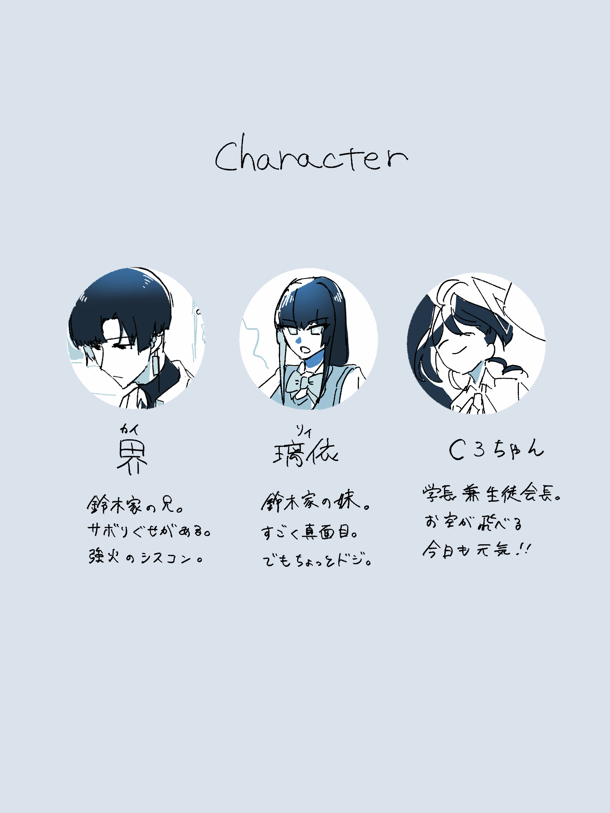
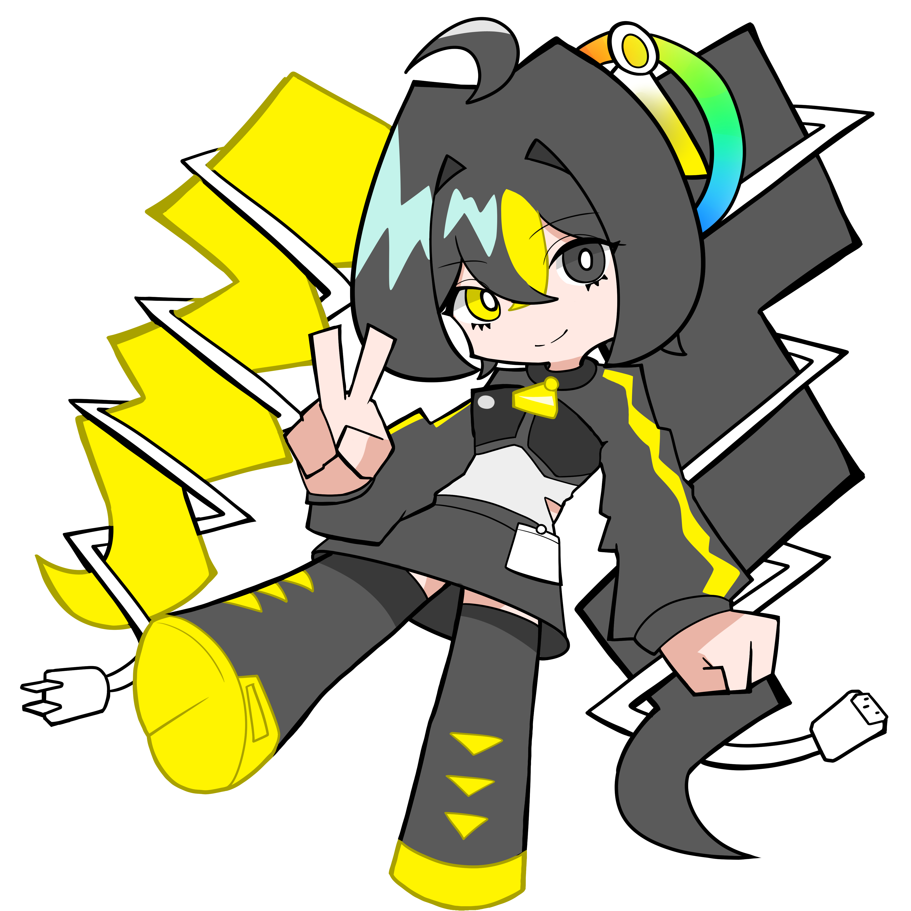
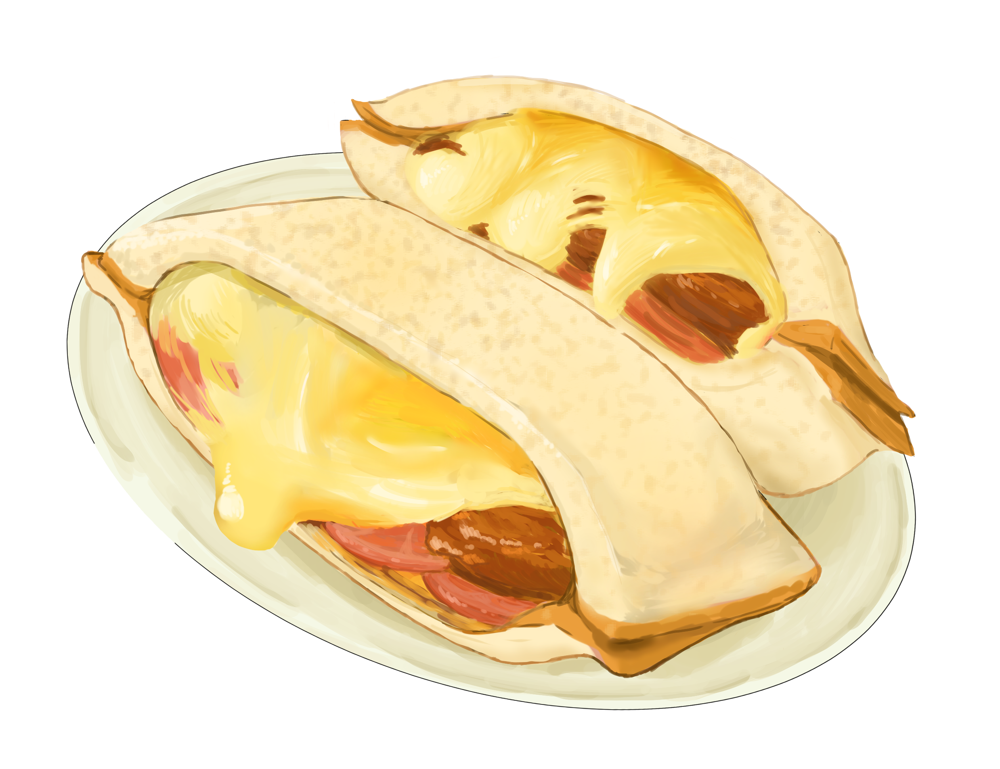
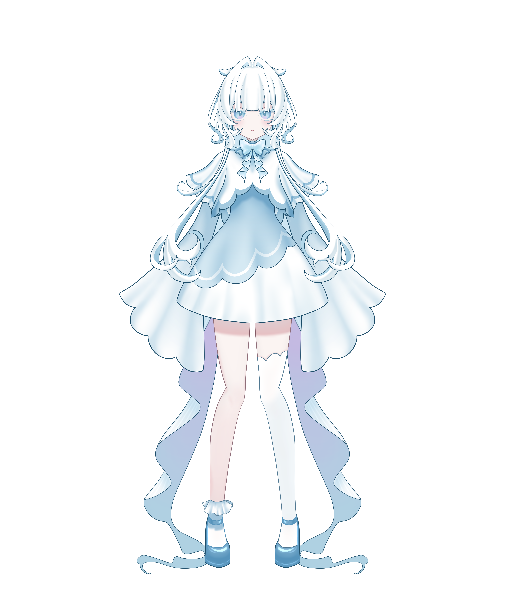

## 概要
この分野ではデジタルイラストやビジュアルデザインなどの創作を行っています。
主にibisPaintやCLIP STUDIO PAINT、Adobe、Live2Dなどのツールを使用しています。

## 作品紹介

## 使用ツール
MediBang Paint / ibisPaint / CLIP STUDIO PAINT / Procreate / adobe fresco / Artstudio Pro / コンセプト / 熊猫绘画 / AfterEfects / AdobePremiaPro / aviutil / etc