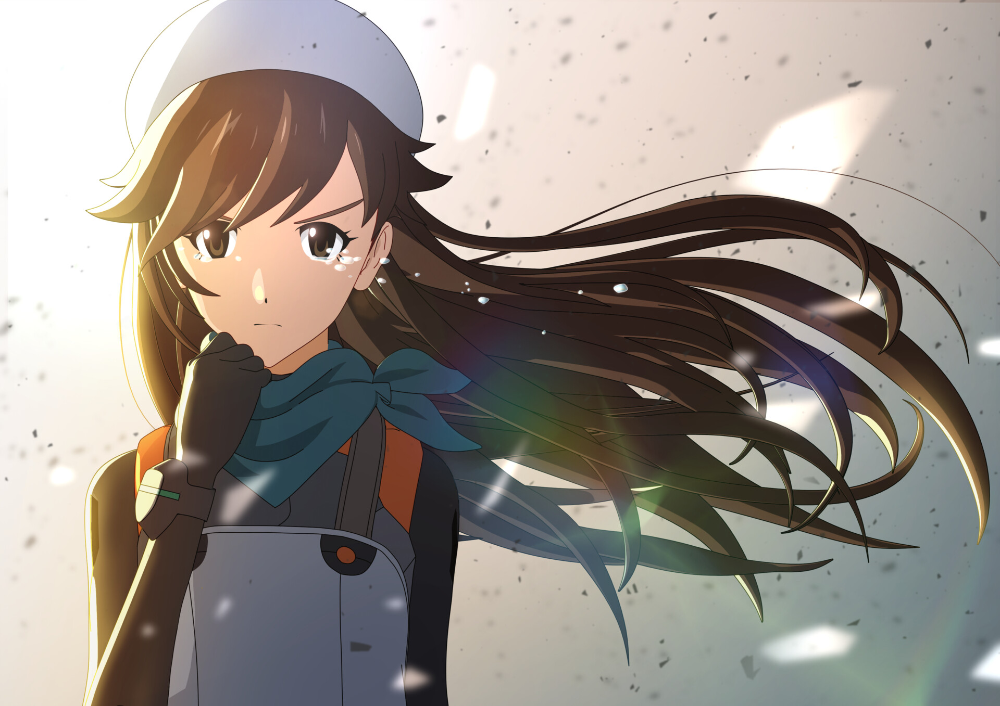
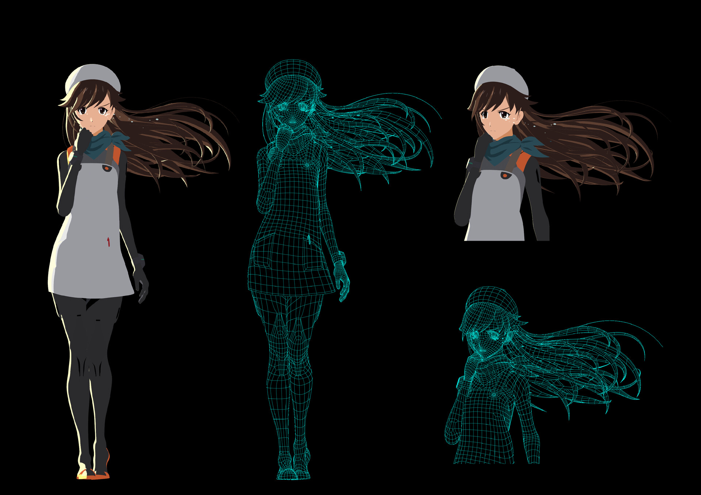
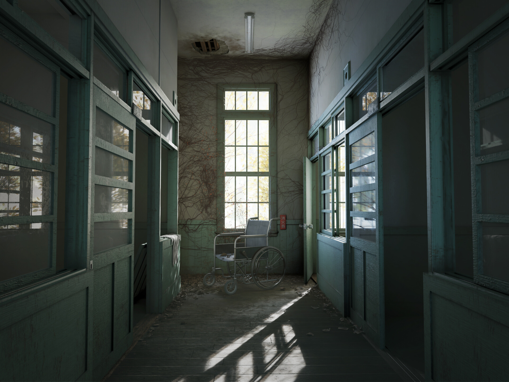
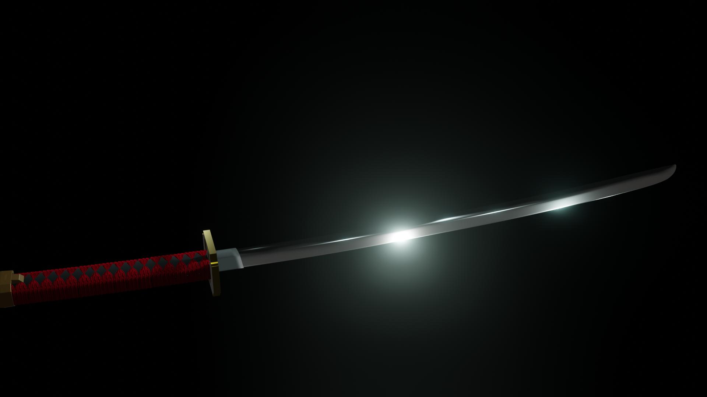
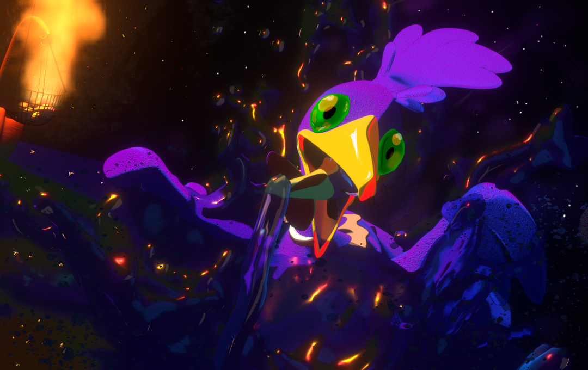
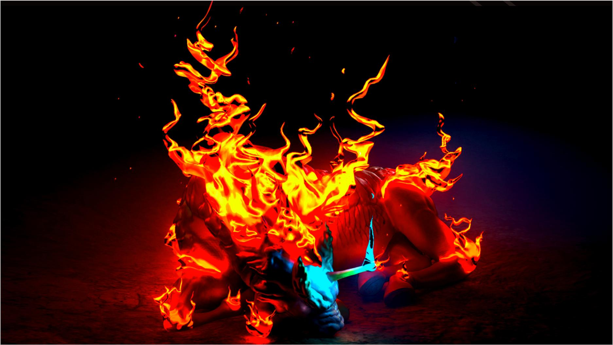

# CGとは
Computer Graphicsの略称です、イラストなども定義的にはCGですが、C3では基本的に3Dの分野のことを指し、3Dモデリングやアニメーションなどの制作を行う人が集まっています。使用ソフトとしてはBlender やMaya、Zbrushなど、さらにはPhotoshopやAeなど様々ソフトが活躍しています。

### 作品紹介
この分野は部員一人ひとりの個性が光る分野でもあり、かわいいキャラクターたちやクリーチャー、はたまた銃火器など自由に制作を行っています。
以下作品紹介です

---

**「誓い」**

シン・エヴァンゲリオン劇場版𝄇より鈴原サクラを作りました。
アニメCGコンテストでグランプリに選出された作品です。

**「忘れ物」**

廃病院をモデリングしました。
ライティングを意識してこの空気感を作りました。

**「日本刀」**

刀身の美しさを大切に作成しました

**「鵜飼い」**

ウッウとトレーナーはどんな形の日常を送っているのか想像して制作した作品です

**「太平の世」**

太平の世にだけ現れるという幻獣・麒麟、彼が終わった荒野で何を思うのだろうか
