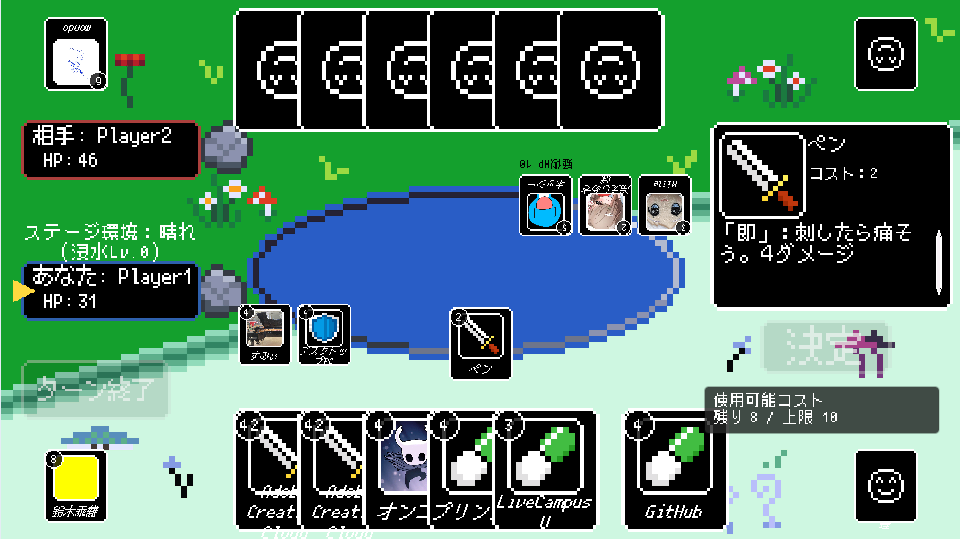
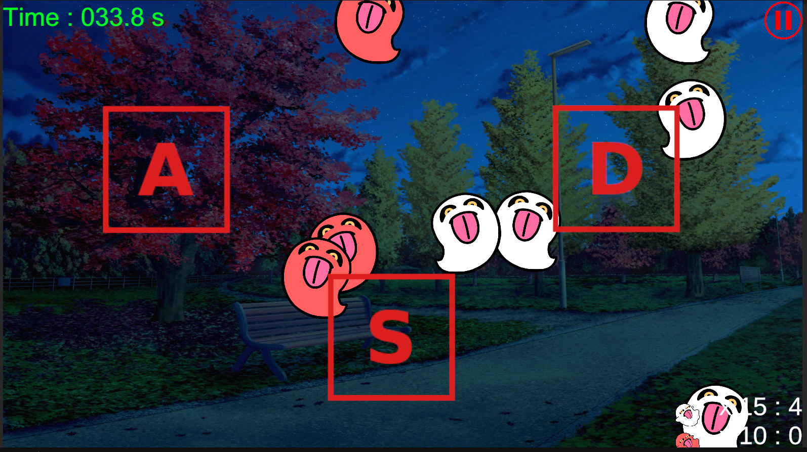
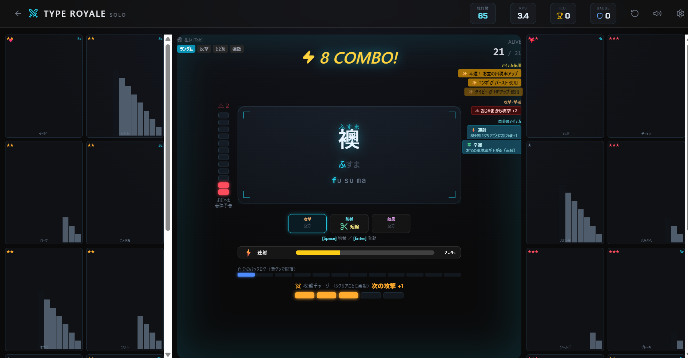
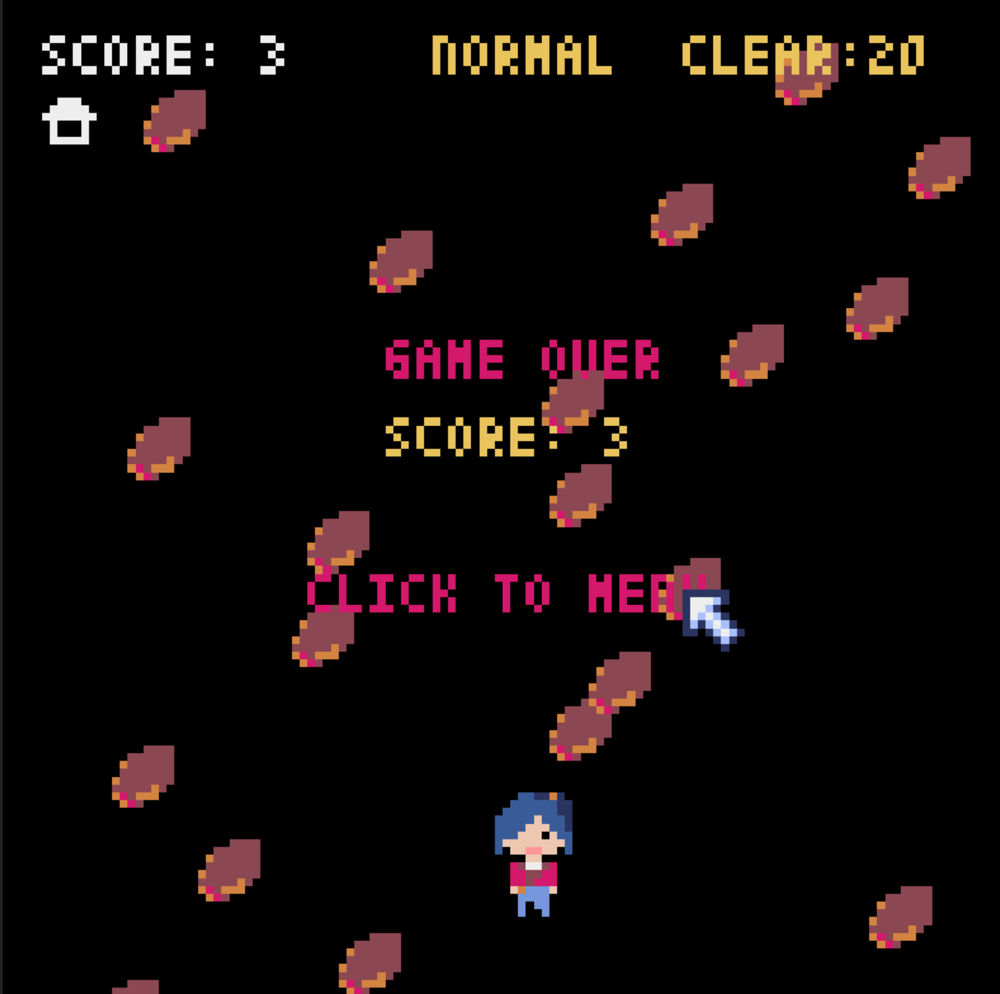
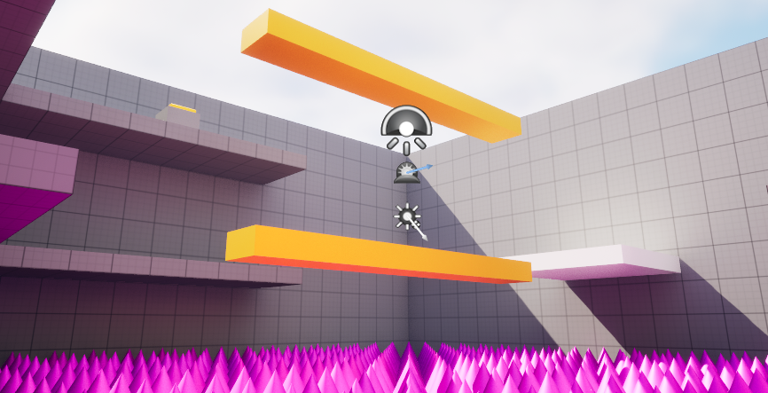

## 概要
この分野ではUnityやUnreal Engine、Godotなどのゲームエンジンを使って創作を行っています。
ゲーム制作はプログラミング能力だけでなく、2Dイラストや3Dモデルを作る必要がある場合もあり、一人でそれらを全て用意するとなるととても大変です。しかし、C3にはそれらを得意とする部員がいるので、協力してゲームを作ることが可能です。みんなで話し合って行う創作は楽しいので、興味があったらぜひここでチャレンジしてみてください！！！

## 作品紹介

