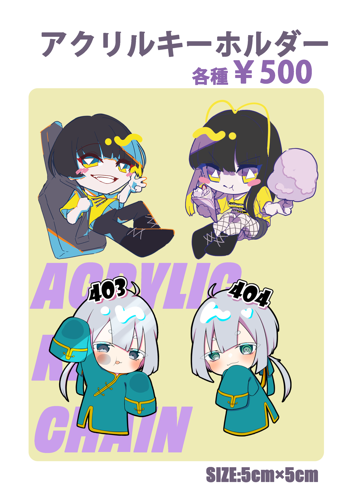
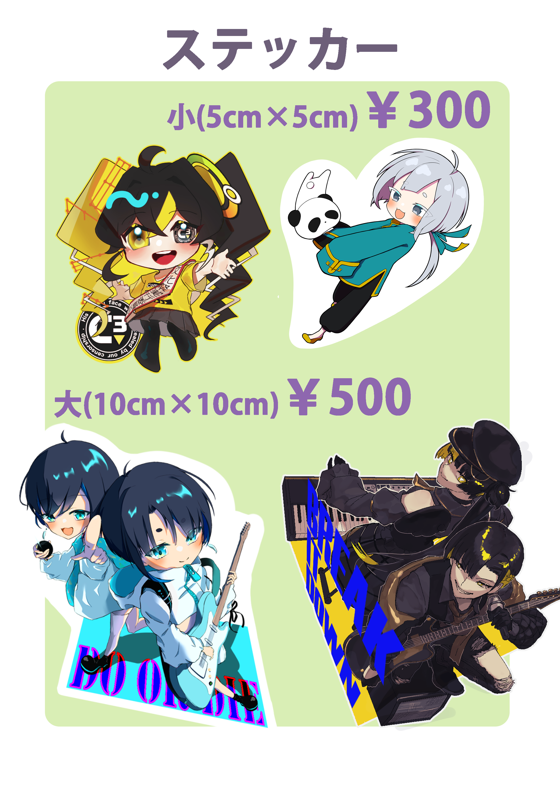
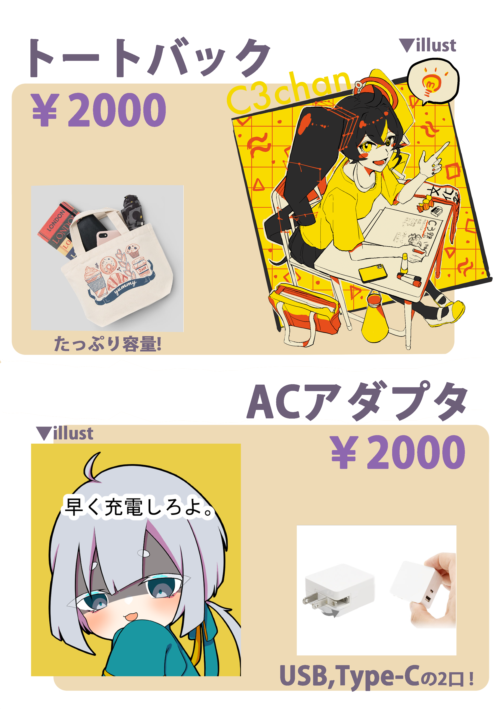
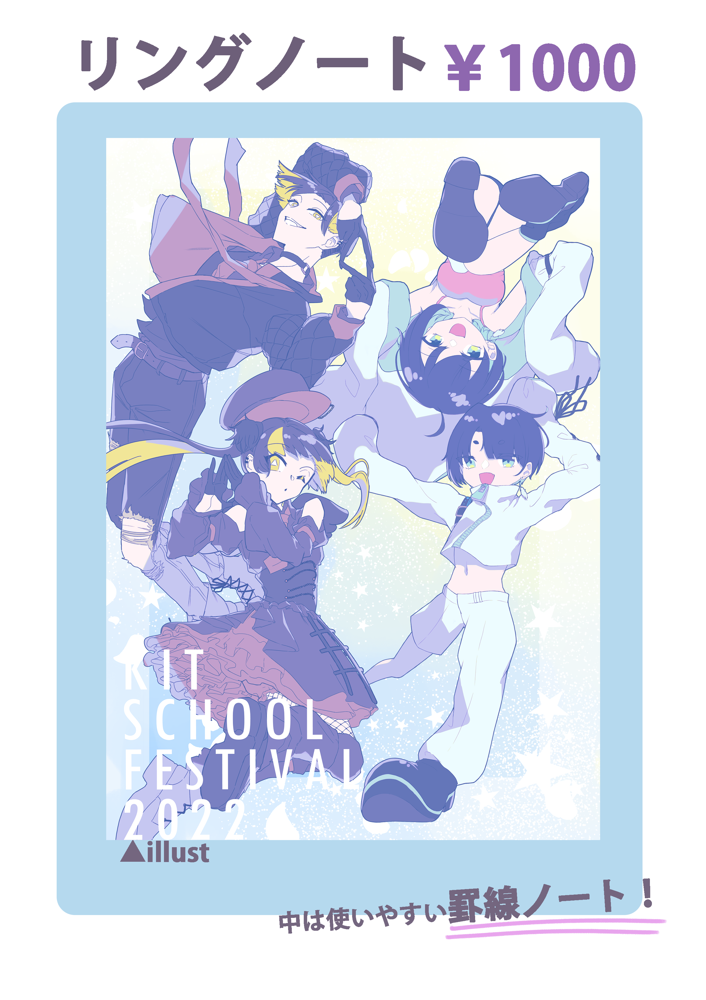
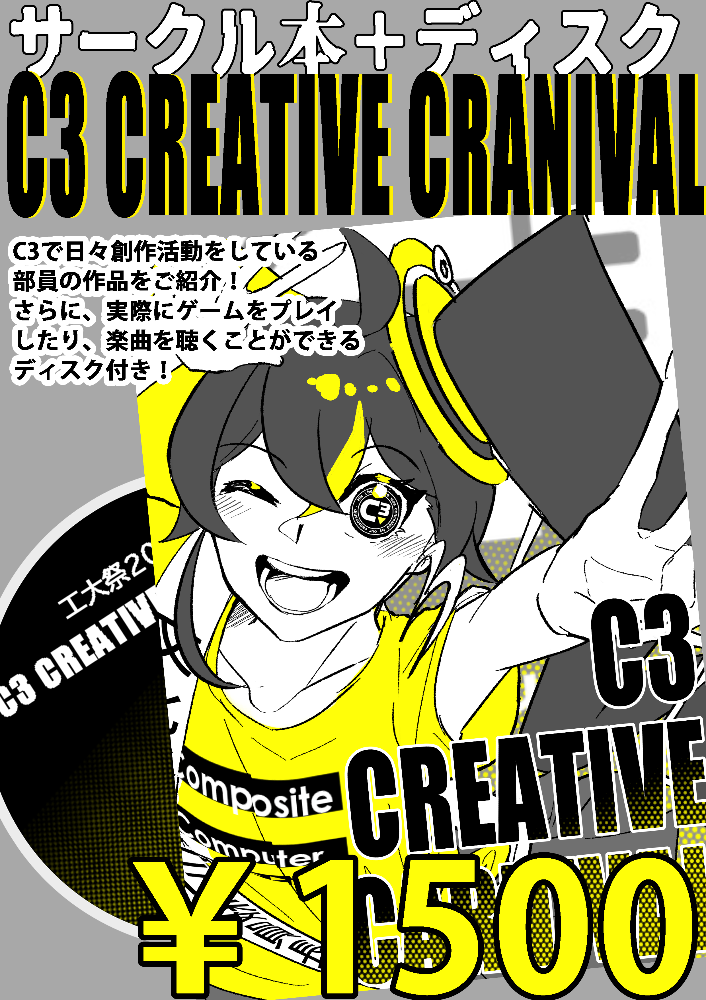

# 2022年度工大祭のサークル展示と模擬店のお知らせ

C3はサークル展示と模擬店を出展します！
__サークル展示__ は部員の作品やスコアアタックゲーム（スペースファイター）を展示します！
模擬店はグッズ販売を行なっています！グッズはC3のサークル作品の本とDVDのセットと個人制作のオリジナルグッズがあります！！

詳しくは以下に↓

## サークル展示について
場所：　講義棟1302
内容：　
- __C3部員の作品展示__
- __スコアアタックゲーム（スペースファイター）__
  - 決められたスコアを達成すると模擬店で販売しているグッズの**割引券**が貰えるよ！！！
- __作業展示__
  - 部員がその場で作業を行うので、見るのもよし！質問するのもよし！です
  - イラストや３Dモデル、プログラミング、などの作業が見られるかも！！

## 模擬店について
場所：　グラウンド
内容： __グッズ販売__

__お品書き__

| お品 | 価格 |
| ---------- | ---------- |
| ステッカー（小） | 300円 |
| ステッカー（大） | 500円 |
| アクリルキーホルダー | 500円　|
| ACアダプター | 2000円 |
| トートバック | 2000円 |
| リングノート | 1000円 |
| サークル本 ＋ ディスク | 1500円 |

## 工大祭について
開催期間：　10月8日・9日
場所：　九工大飯塚キャンパス
注意事項：　
- 一般方は事前申し込みが必要です！
- 詳細は工大祭HPを確認ください！！
[__工大祭HP__](https://kit-festival.jp/)