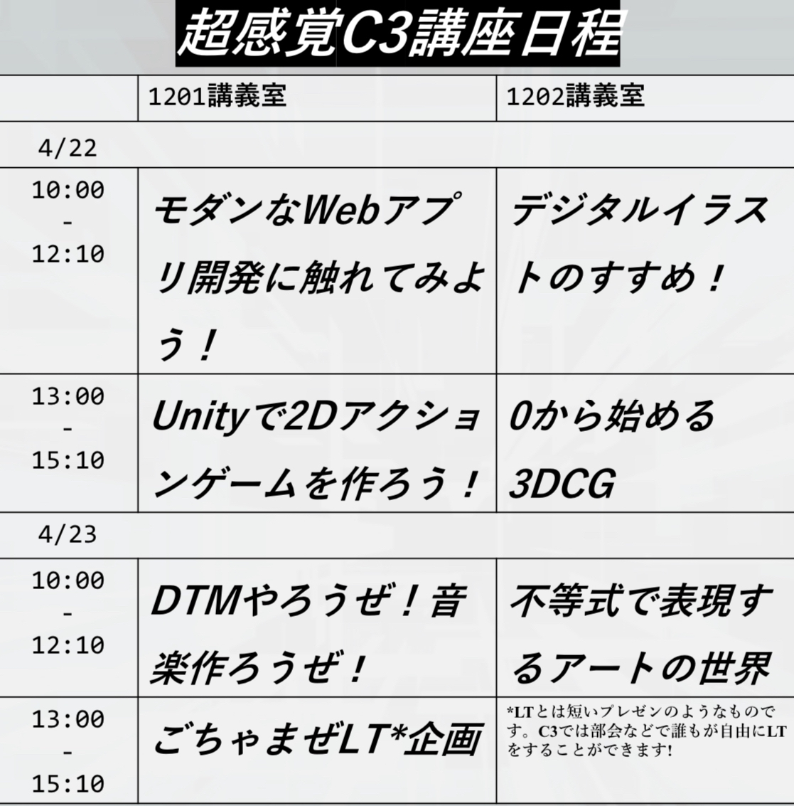
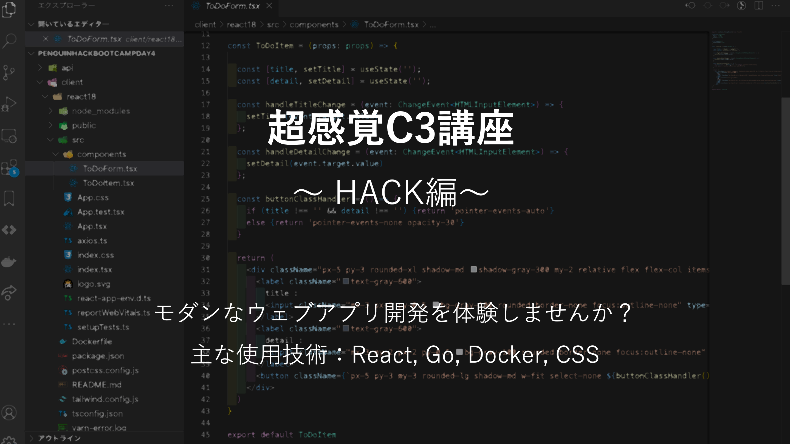
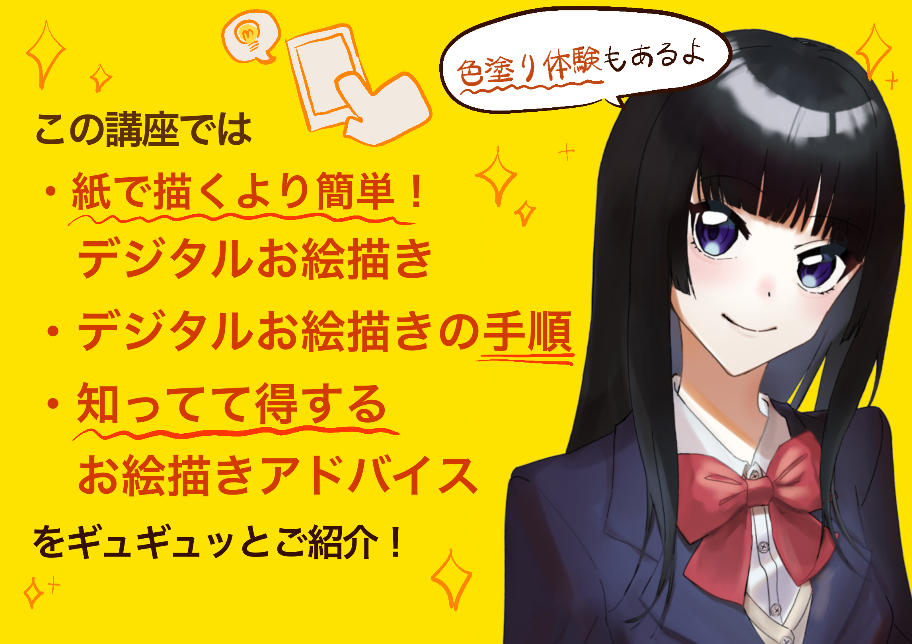
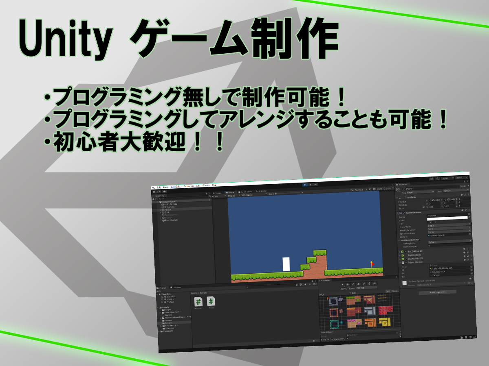
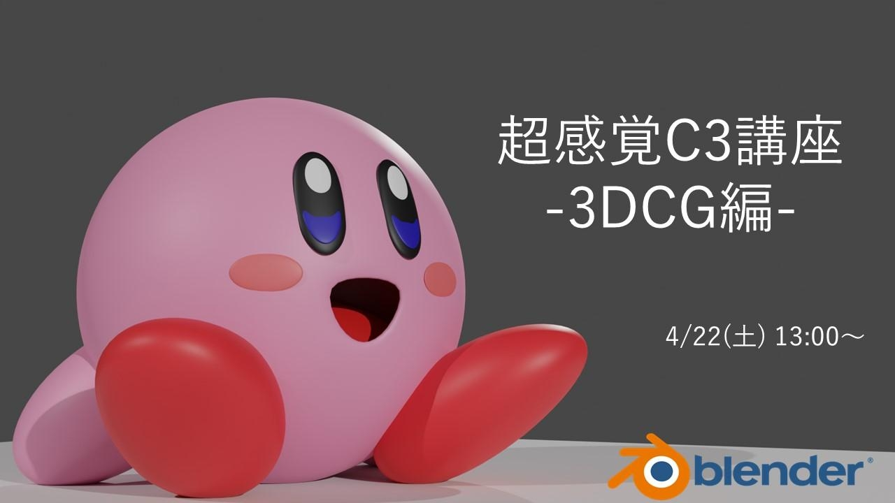
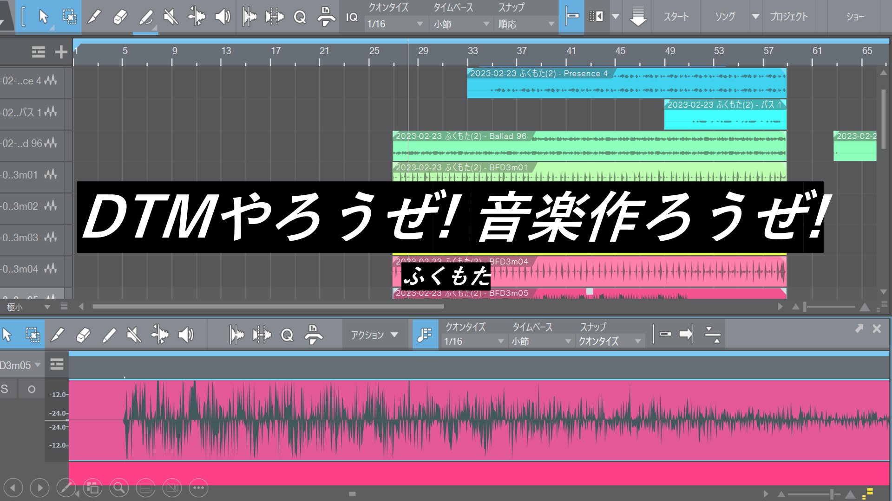
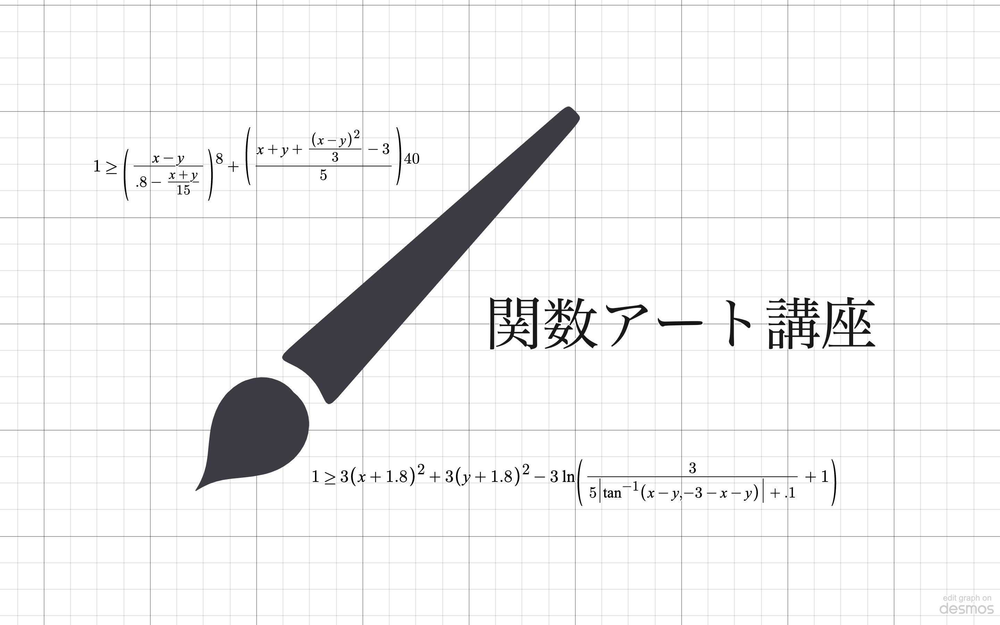
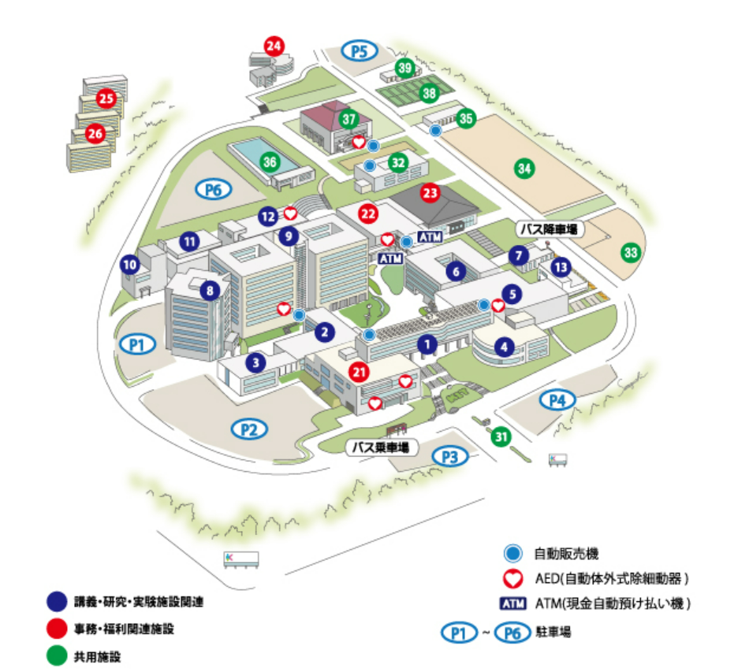
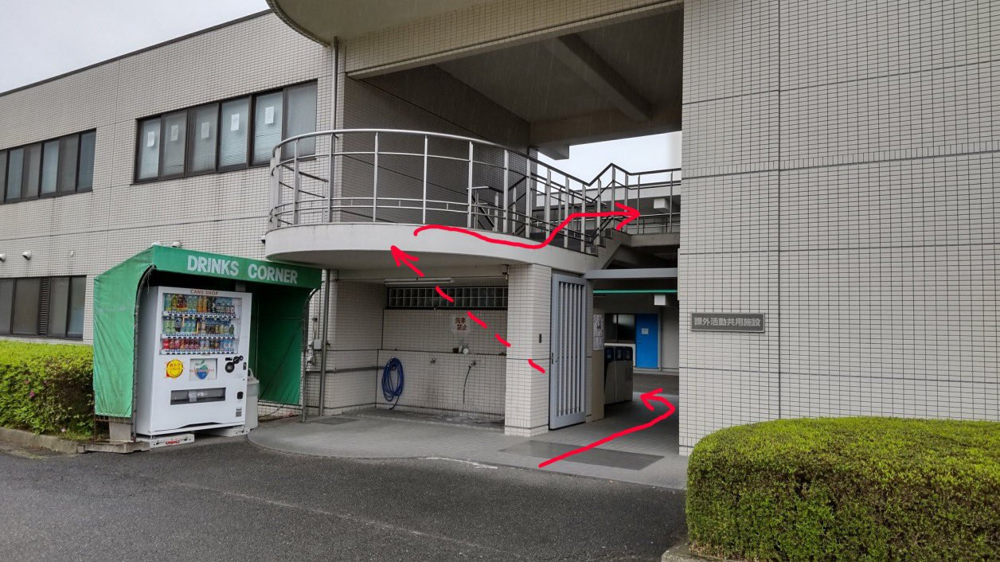
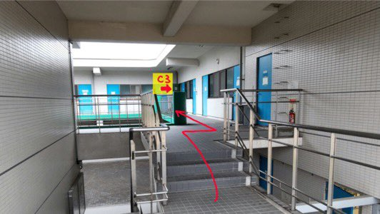

新入生の皆さん、ご入学おめでとうございます！
在校生の皆さんは今年も頑張りましょう！

さて。
__新年度となり、サークル何にしようって悩んでいるそこのあなた！__
__心機一転、新しいことを始めてみたいと思っているそこのあなた！__

__C3、見学に来てみませんか？__
思い切って入部してくれても大丈夫ですよ！

今回は、C3に興味がある方からとりあえずなんか部活やりたい方まで優しく受け止める、
C3の今年度の新歓企画についてご紹介します！

# C3ってまずどんなサークル？
C3は __「コンピュータでモノづくり」__ するサークルです？
正式名称は「CompositeComputerClub」です。

コンピュータでモノづくり、って具体的に何かというと、
ゲーム、イラスト、3DCG、音楽、Webサイト...などなど、挙げていくとキリがないけど、
とりあえず自分の好きなものを作っています！

__もっと知りたい方は、このサイトのいろんなページを見てみてね！__

# ◎新歓企画一覧
まず、企画一覧はこんなかんじ。

__4/16　   サークル紹介企画（部活動紹介）__
__4/17-21　部室見学期間__
__4/22,23　超感覚C3講座（最重要）__

1つずつ説明していきますね！
__最後のは特に見てほしい！！！！！！__

## 1. サークル紹介企画
こちらはOMCASさんが開催するサークル紹介企画に参加します。

C3は、 __部室で部の説明と部員の作品紹介を行う__ 予定です！
どんなもの作っているんだろう？って具体的に知りたい方は、他のサークルを見るついでに来てくださいね！
あなたのことを知りたい先輩が待っています！

__日程：4/16（日） 10:00~17:00__
__場所：部室（サークル棟 共用室7）__

※最初は部室のあるサークル棟の位置が分かりづらいので、この記事の最後に部室への行き方を説明しますね。

## 2. 部室見学期間
こちらは学校が指定する部活動見学期間に便乗します。

基本的には1つ目の企画とやること一緒です！
こっちは授業終わりに来やすいと思うので、日曜日が予定があってこれない人はぜひ来てください！

ただ、曜日によって場所が変わるので注意です！

__①部室見学__
__場所：部室__（サークル棟 共用室7）
__日程：4/17（月）-20（木） 18:00~20:00__

__②部会見学__
__場所：1203、1204講義室__（講義棟2階）
__日程：4/21（金） 18:00~20:00__

C3では、毎週金曜日に部会を開催しています！
部会では、部についての連絡を行った後に対面での作業会を実施しています。
※部会中でも講義室に突撃してOK！近くの先輩に「C3見学に来ました」と伝えてね

## 3.超感覚C3講座
__一番来てほしいイベントです。要チェック！__

このイベントでは、__実際に普段部員が行っている活動を体験することができます__。
学校の授業のような形式ですが、
全く知識0の方でも大丈夫なように、丁寧に講座を進めていきます！

講座情報のスケジュールと場所はこちら！

__【参加方法】下のフォームに回答__
https://forms.gle/Ke6MmfhmFvmTnX3R7

## ▼講座紹介
### モダンなWebアプリ開発に触れてみよう！

ウェブアプリ作りたいですよね。
この講座ではウェブアプリ開発に興味がある人向けに、モダンな技術構成の簡単なウェブアプリの開発環境を手元で動かし、ウェブアプリ開発を体験してもらいます。

日程：4/22（土）10:00-12:10　※10分休憩含む
場所：1201講義室
準備物：PC, VSCode, GitHubアカウント, Docker, Dockerアカウント
  ※各種アプリケーションの事前準備をお願いします。
  [事前準備手順](https://chivalrous-botany-faf.notion.site/3ab5c0cf211a4afd9efb196e64e45990)

### デジタルイラストのすすめ！

みなさん、推し絵師が神イラスト描いてて「俺も描きてぇ〜」ってなったことはないですか？
でも難しそう…って悩んでるそんなあなた！
この講座では、イラストを描く工程を0から100までお教えします！
知識０の方大歓迎！あなたも神絵師目指しませんか？

日程：4/22（土）10:00-12:10　※10分休憩含む
場所：1202講義室
準備物：スマホのみ

### Unityで2Dアクションゲームを作ろう！

皆さん、ゲームを作ってみたいと思ったことはありませんか？
この講座ではUnityというゲームエンジンを用いてゲーム制作を体験することができます！
プログラミング要らずで楽しくできちゃいます！自分だけのゲームを作って楽しみましょう！

日程：4/22（土）13:00-15:10　※10分休憩含む
場所：1201講義室
準備物：PC

### 0から始める3DCG

3DCGの世界を体験してみませんか？
本講座では無料ソフトblenderを用いて、画像のような立体物を作る方法をお教えします。

下記URLよりblenderをダウンロードしてご参加ください！
https://blender.org

日程：4/22（土）13:00-15:10　※10分休憩含む
場所：1202講義室
準備物：PC、3ボタンマウス、blender

### DTMやろうぜ！音楽作ろうぜ！

皆さんは音楽を作りたいと思ったことはありますか？
本講座では作曲の仕方について説明した後、実際に皆さんに音楽を作ってもらう講座になっています。
音楽が全く分からない方でも、我々が全力でアシストするのでぜひ参加してください。作曲は楽しいですよ！

日程：4/22（日）10:00-12:10　※10分休憩含む
場所：1201講義室
準備物：Studio One 6 Prime、マウス、PC
       ※Studio One 6 Primeの事前DLをお願いします。

### 不等式で表現するアートの世界

「関数アート」という新しいアートの世界をご存知でしょうか．
本講座では，インタラクティブにグラフを学ぶことができるグラフ計算機desmosを利用して，数式で絵を描く方法をお教えします．

日程：4/22（日）10:00-12:10　※10分休憩含む
場所：1202講義室
準備物：PC

## ごちゃまぜLT企画
ここでは、普段の部会で部員が行っている「LT」を見てもらおうと思います！

LTとは、簡単に言えば __「短時間のプレゼン」__ みたいなものです。
プレゼン、というとつまらなさそうですが...
C3で行われるLTは、みんな「私のやってること面白いから見て～！！！」って訴えかけてくれます。

そんなLTを、今回はいろんな分野から集めてきました！
（プログラミング、3DCG、ゲーム等々...）
__「ものづくりをやってみたいけど、何をしようか迷っている...」って人にピッタリの講座です！__

まずはこの講座を聞いてみませんか？

日程：4/22（日）13:00-15:10　※10分休憩含む
場所：1201講義室
準備物：楽しみにしてくれるその心

# ◎入部方法について
もうすでに「入部したい！」と思ってくれたあなた！
なんと、もう入部できちゃいます！

入部の手続きは簡単なのですが、ちょっと準備が必要なので先に方法を読んでから作業を行ってください！

【入部の方法】
1. 「Discord」というサービスのアカウントを持っていない場合、まずアカウント登録をしてください。
　※C3では部の連絡をすべてDiscordで実施します。
3. 下のフォームに回答
https://docs.google.com/forms/d/1-vaWgU3sz0As4l6Qb8HbvUOYlP48WkVAlygiBPRZfdM/edit#responses
3. フォーム回答終了後のページに表示されるDiscordの招待リンクを押して、C3のサーバーに入る
4. 入部完了！

3について、
もし入部届を出したけど、Discordのサーバーに入れなかった人は
C3公式TwitterのDM、またはC3のメールまでご連絡ください！

Twitter：@c3_kyutech（https://twitter.com/c3_kyutech）
C3のメール：c3gidai@gmail.com

# ◎C3の部室への行き方
__1. マップの32番までどうにかたどり着く（頑張って！！！！）__
マップのリンク：https://www.iizuka.kyutech.ac.jp/access

__2. 入り口左手の階段を上る__

__3. 上って直進し、角の部屋がC3の部室です__

皆さんのことを温かくお待ちしております✨