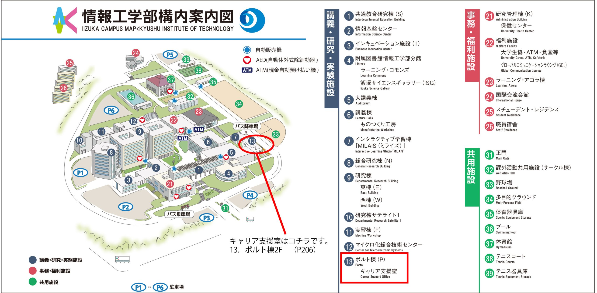
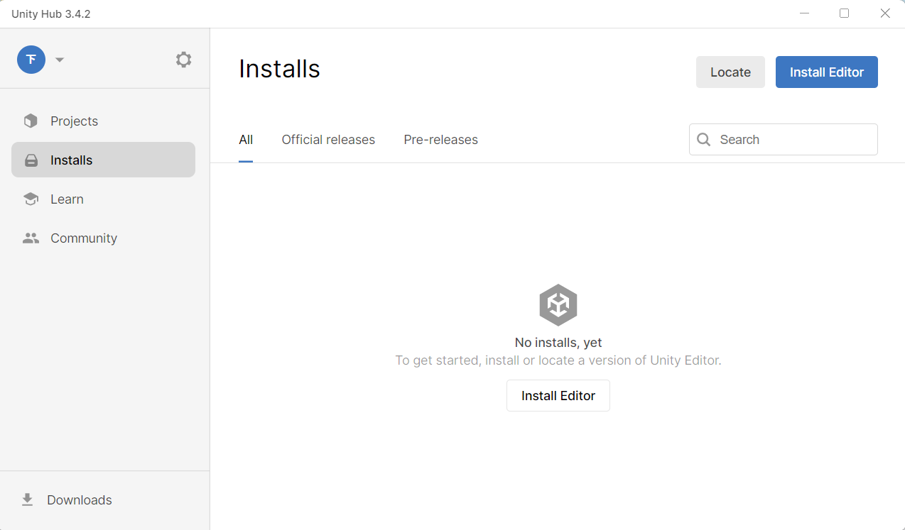
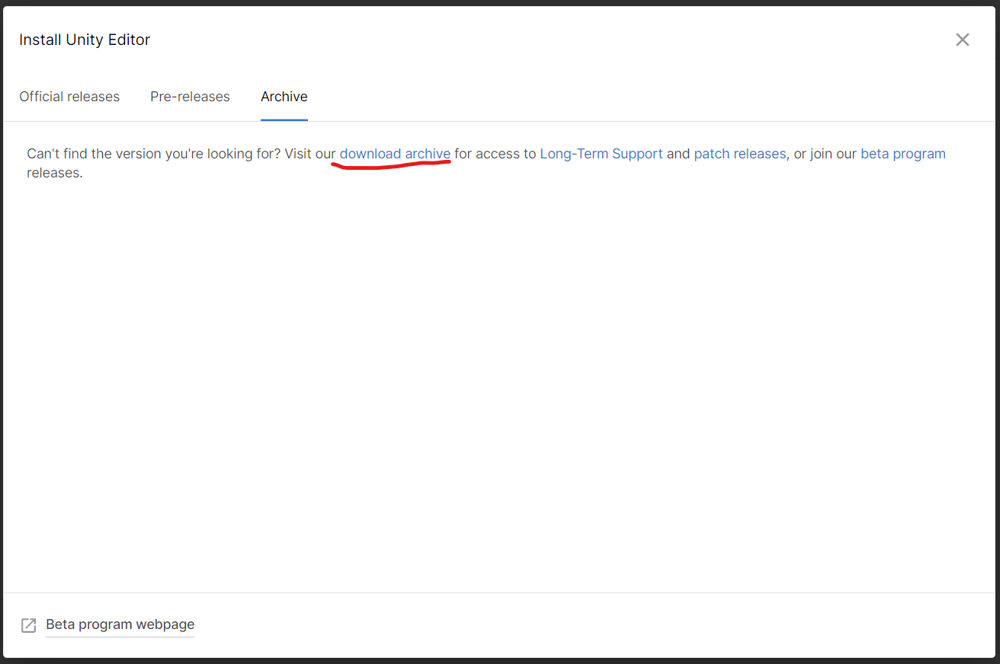
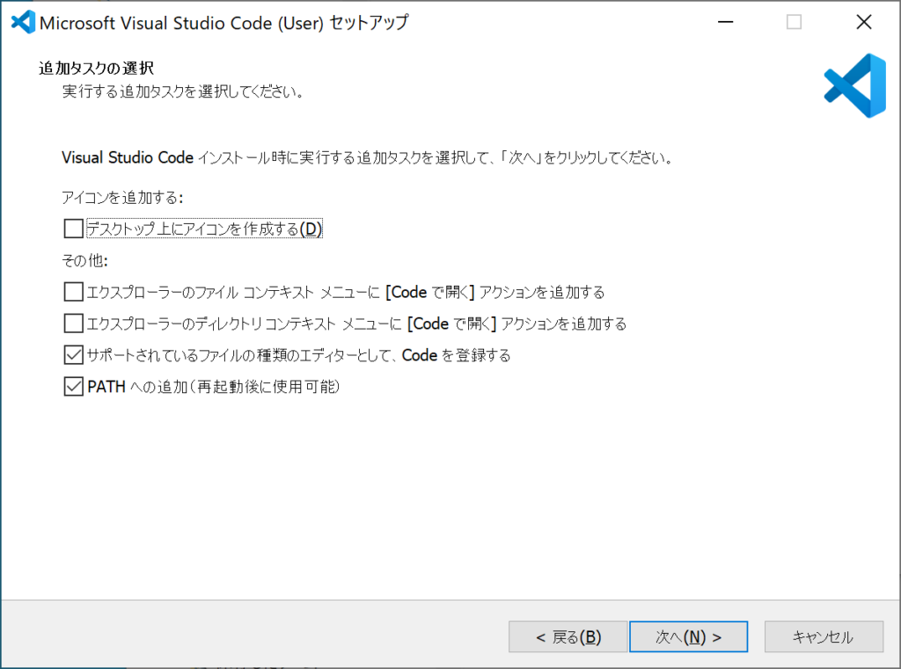
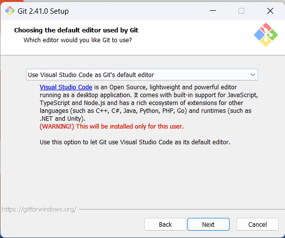

## 概要
iPhone 12 Pro以降のモデルで搭載された[LiDARセンサー](https://time-space.kddi.com/ict-keywords/20201204/3020)を用いて、さまざまなものを3Dスキャン出来るようになりました！今回はそのLiDARセンサーを用いてスキャンした[点群データ](https://besterra3d.com/blog/knowledge/002459.html)をモデルデータに変換し、UnityやWebで扱う方法を実際に手を動かしてもらいながら体験してもらいます！

また、LiDARセンサーを用いた株式会社オプティムの企業向け測量サービス（[Geo Scan](https://www.optim.co.jp/construction/optim-geo-scan/)）を使った測量を何人かの人に体験していただけます！

## 基本情報
日時：2023年6月21日（水） 17:00-19:30（16:40受付開始）
場所：九州工業大学　飯塚キャンパス　ポルト棟（希望が多ければオンラインでの配信も行いますが、質問対応などは出来ませんのでご了承ください）
対象：九工大　情報工学部生　全学年
必要なもの：PC（Windowsを想定）、マウス（ゲーム制作に参加する人）
※資料はWindows PCを想定しています。Windows以外のPCの方は適宜、事前準備や説明資料を読み替えてください。

| 時間     | 内容     |
| ---------- | ---------- |
| 17:00〜１7:30 | オープニング |
| 17:30〜18:50 | ハンズオン|
| 18:50〜19:00 | クロージング |
| 19:00〜19:30 | 懇親会 |

※　懇親会は任意参加です



## ハンズオン
２分野同時開催のため、どちらか一方のみ参加可能です。
最初に２分野合同でLiDARセンサーや点群データの説明、Geo Scanの体験などを行ってから、各分野でのハンズオンを行います。

| 分野     | 内容     |
| ---------- | ---------- |
| ゲーム制作 | スキャンした3Dモデルで簡単なゲーム作成！！<br>Unityで3Dの簡単な的当てゲームを作成します。<br>使用技術：Unity |
| Web制作 | 3Dモデルビューアーの実装！<br> Three.jsというWeb上で3Dモデルを扱うjsライブラリを用いて3Dモデルビューアーを作成します<br>使用技術：React.js, TypeScript, Three.js, etc |

## ↓↓申し込み↓↓
参加申し込み後、入力していただいたメールアドレスにメールをOPTiMから送らせていただきます。また、イベント当日までに、**事前準備**を終わらせておくようにお願いします。

また、**参加しない場合**でも今後の技術系イベント（オプティム主催）の案内が欲しい方は回答していただくと、イベントの案内を記入していただいたメールアドレスにオプティムから送らせて貰います。

[申し込みフォーム](https://forms.office.com/pages/responsepage.aspx?id=8CvYb31Oq0OtIZ61pLtaDUGXgy_qFS9ImGoXTAC8wM1UMTJZS0FBMTlBSlo2QUNUU1IxWEhXMlVBUC4u)


## 事前準備
当日、環境構築等を行う時間がないため、参加する方は当日までに以下の事前準備を終わらせておいてください。
### ゲーム制作
- [UnityHub](https://unity.com/ja/download)のインストール
  - インストール完了後、ログインをしてください。アカウントがない場合は作成してください。
  - サインイン後モーダルが出るので、適宜選択して進めてください。
  - 画像の右上のInstall Editorをクリックしてください
    
  - Archiveを開き、画像の赤線のdownload archiveをクリックしてください
    
  - `2021.3.25`のバージョンを探し、青色ボタンの`Unity Hub`をクリックし、インストールしてください。オプションは何も設定しなくて問題ありません。
  - インストールには時間が掛かると思いますので、余裕を持って行ってください。

### Web制作
- [Docker Desktop](https://www.docker.com/products/docker-desktop/)のインストール
- [VSCode](https://code.visualstudio.com/download)のインストール
  インストールの際はPATHへの追加にチェックを付けてください
  
- [git](https://gitforwindows.org/)のインストール
  - `Choosing the default editor used by Git`は`Use Visual Studio Code as Git's default editor`を選択する
    
  - その他の設定は全てデフォルトでOK
  - インストール完了後、一度PCを再起動させてください
  - コマンドプロンプトで以下を実行し、バージョンが出ればOKです
    ```sh
    git version
    ```
- [git-lfs](https://git-lfs.com/)のインストール
  - インストール完了後、コマンドプロンプトで以下のコマンドを実行してください
    ```sh
    git lfs install
    ```
  - コマンドプロンプトで以下を実行し、バージョンが出ればOKです
    ```sh
    git lfs version
    ```

## 主催情報

### 株式会社オプティム
担当：企画、運営など
概要：東京に本社、佐賀に本店（佐賀大本庄キャンパス内）を置くIT企業です。農業や医療などの様々な産業のDXを推進するサービスを開発、提供しています。
HP：https://www.optim.co.jp/
テックブログ：https://tech-blog.optim.co.jp/

### Composite Computer Club (C3)
担当：企画のお手伝い、宣伝、メンターなど
概要：1987年に創立した九州工業大学　情報工学部　飯塚キャンパスを拠点に活動する九工大公式サークルです。コンピュータを用いた幅広いデジタル作品の制作活動を行っています。
HP：https://compositecomputer.club/
作品：https://toybox.compositecomputer.club/
Twitter：https://twitter.com/c3_kyutech