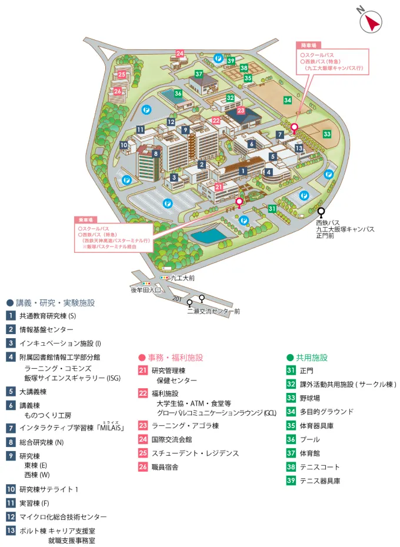
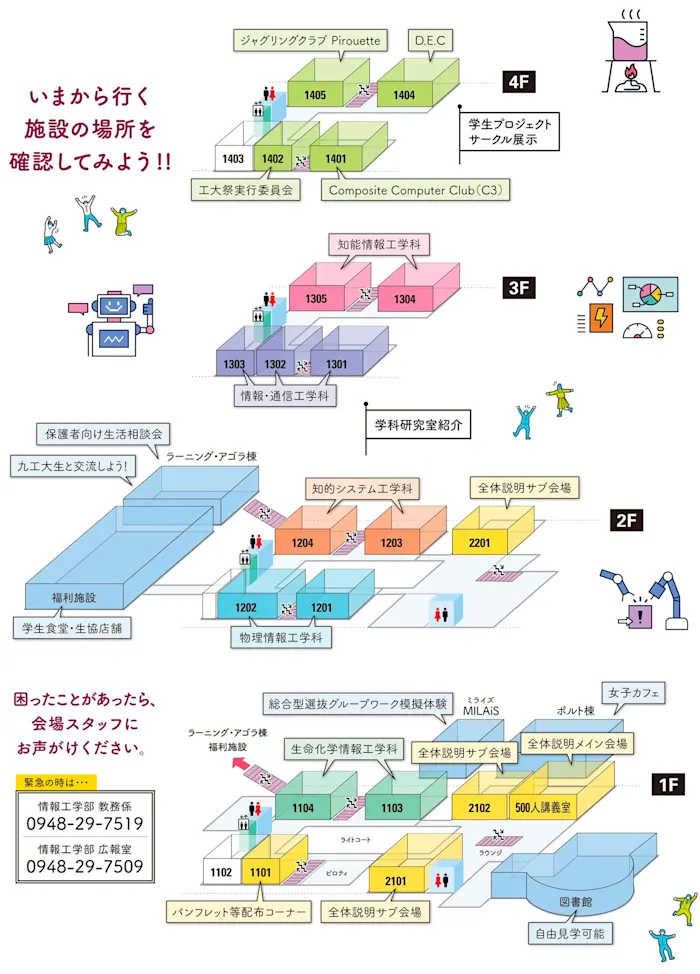

**今年も[九州工業大学情報工学部オープンキャンパス](https://www.iizuka.kyutech.ac.jp/admissions/open/open2023)の開催に合わせて、特設サイトの公開やサークル展示を行います！**

## 特設サイト公開中！！
**[OC2023特設サイト](https://oc2023.compositecomputer.club/web)**
[九州工業大学 情報工学部 オープンキャンパス特設サイト](https://www.iizuka.kyutech.ac.jp/admissions/open/open2023)

## サークル展示
場所：　九州工業大学　飯塚キャンパス（下図の６番）　1401講義室
時間：　7月15日（土）10:00-15:30、7月16日（日）10:00-15:00

