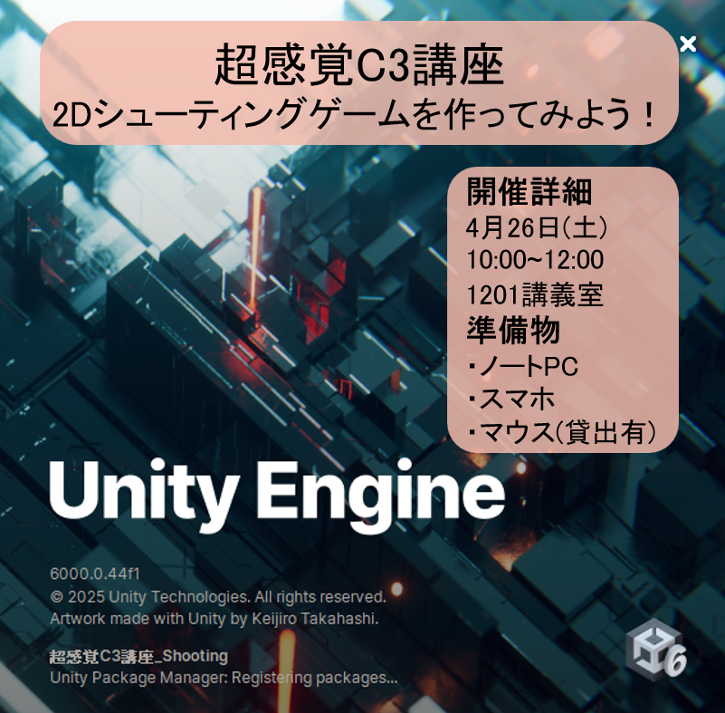
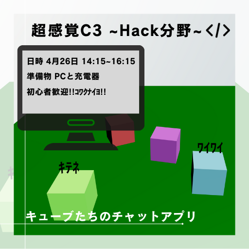
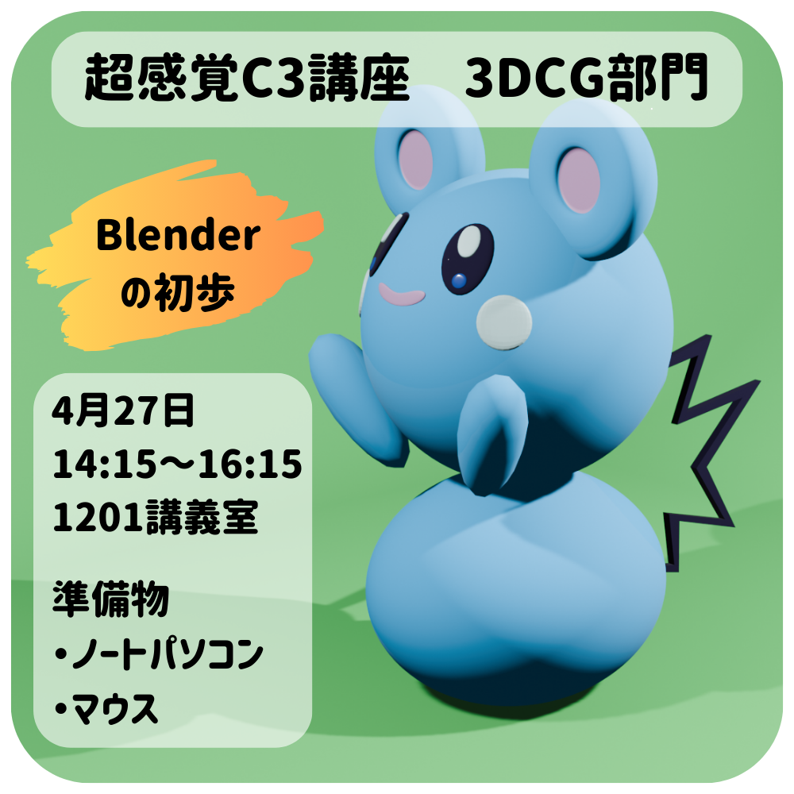
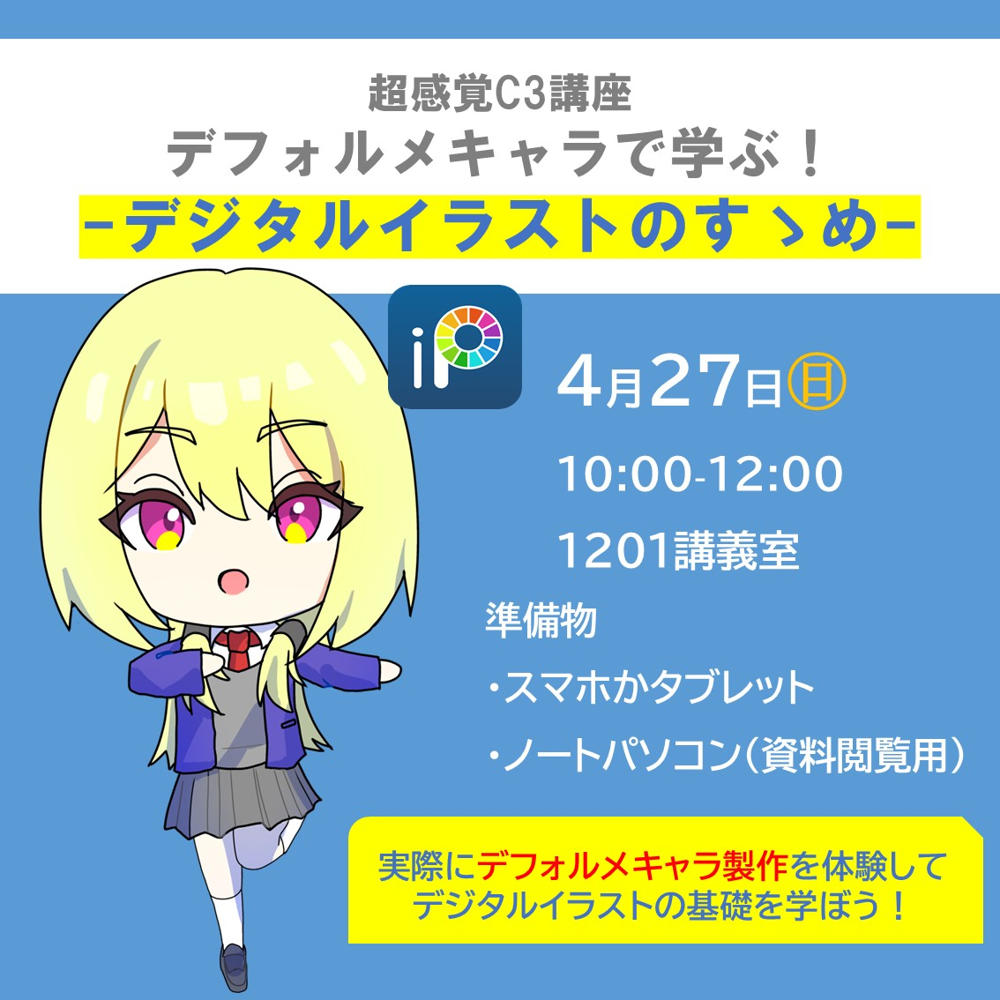
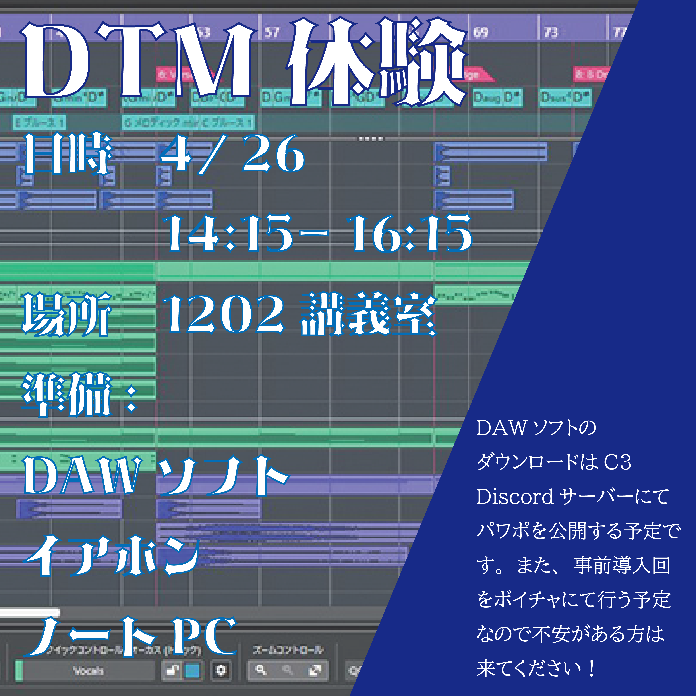
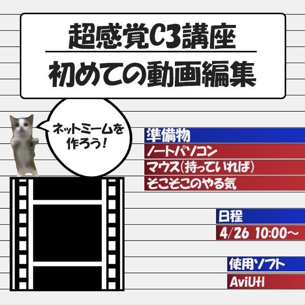
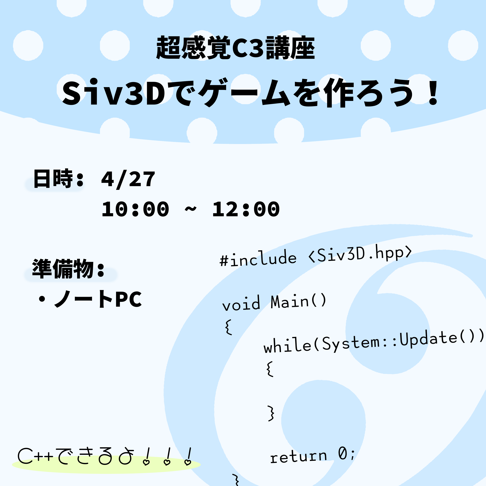

# 超感覚C3講座 開講！
著：Snow

## 超感覚C3講座とは？

"超"感覚的に、C3を体験できる講座です。

もう少し具体的に？

仕方ないなぁ。

C3で、よく制作されているゲームや、Webサイト、イラスト、3DCG、音楽などなどを、実際に手を動かして“感覚的に”体験することができる、講座です。

例えば、私が担当する3DCGの講座「Blenderの初歩」では、Blenderの基礎的な操作を中心とした、キャラクターモデリングを行う講座で、パソコンとマウスを実際に動かし、モデリングを体験してもらいます！

「3DCG(モデリングBlender)」他にも、本年度は、「GAME(ゲーム制作Unity)「HACK(アプリ開発)」、「2DCG(イラスト制作)「MUSIC(音楽制作)」、「動画編集(動画制作)」、「Siv3D(ゲーム制作)」と、全７講座開かれる予定です！

## 開催日時

### 4/26(土),4/27(日)　に開催！
#### 4/26の部
10:00～12:00　GAME　、　動画編集  
13:00～14:00　Lightning talk 会  
14:15～16:15　HACK　、　MUSIC  

#### 4/27の部
10:00～12:00　2DCG　、　Siv3D  
13:00～14:00　Lightning talk 会  
14:15～16:15　3DCG  

**※土曜は 11:30~13:30 の時間で食堂が開いていますが、日曜は食堂が開いておりませんので注意してください！**

## 開催講座の詳細
### GAME「2Dシューティングゲームを作ってみよう！」
紹　介：　ゲームって楽しいですよね！実は作るのも楽しいんですよ！！  
　　　　　今回は2Dシューティングゲームを作ってみましょう！初心者歓迎です！ぜひ来てね！  
時　間：　26日　10:00~12:00  
準備物：　ノートPC、スマホ、マウス  

### HACK「キューブたちのチャットアプリ」
紹　介：　皆さんこんにちは!!  
　　　　　この文章を読んでいるという事は、キラキラHACK LIFEに憧れがあるという事だね!??  
　　　　　そういうことならこの「超感覚C3講座」でHACKに触れてみよう!!  
　　　　　この講座では3D空間でチャットができるWebアプリの制作ができるよ!!  
時　間：　26日　14:15 ～ 16:15  
準備物：　ノートPCと充電器  

### 3DCG「Blenderの初歩」
紹　介：　無料CGソフトのBlenderを使った、3DCGの初歩的な内容を学んでみませんか？  
　　　　　やってみると案外簡単です！是非チャレンジしてみませんか？  
時　間：　27日　14:15 ～ 16:15  
準備物：　ノートパソコン、マウス  

### 2DCG「デフォルメキャラで学ぶデジタルイラストのすゝめ」
紹　介：　デジタルイラストを始めたいけどきっかけがない…という人のための講座を用意しました。  
　　　　　複雑なイラストアプリをマスターして自分だけのイラストを描いてみよう！  
時　間：　27日　10:00 ～ 12:00  
準備物：　スマホorタブレット、ノートPC(資料閲覧用)  

### MUSIC「DTM体験」
紹　介：　DTM？DAW？なんの略？難しいことは全部すっ飛ばしてパソコンで音楽を作るのを体験しよう！  
時　間：　26日　14:15 ～ 16:15  
準備物：　DAWソフト、イヤホン、ノートPC  

### 動画編集「初めての動画編集～お前もネットミームを作らないか～」
紹　介：　動画編集って何か始めればいいかわからないそこのあなた！  
　　　　　馴染み深かったネットミームの動画を実際に0から作ってみませんか？  
時　間：　26日　10:00 ～ 12:00  
準備物：　ノートPC、マウス(あれば)、そこそこのやる気  

### Siv3D「Siv3Dでゲームを作ろう！」
紹　介：　プログラミングをしてみたい？？それならこの講座を受けてみよう！  
　　　　　この講座では、C++というプログラミング言語を使ってゲームを作るよ！  
時　間：　27日　10:00 ～ 12:00  
準備物：　ノートPC  

## 参加方法
以下のリンクからフォームをご回答ください！
フォーム回答後に、自動でメールを返信しますので、そちらも良くお読みください。  
https://forms.gle/qBtmM7Je8XJU4W667