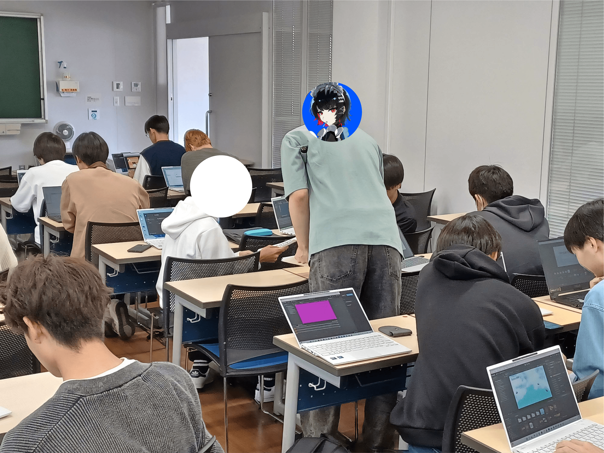
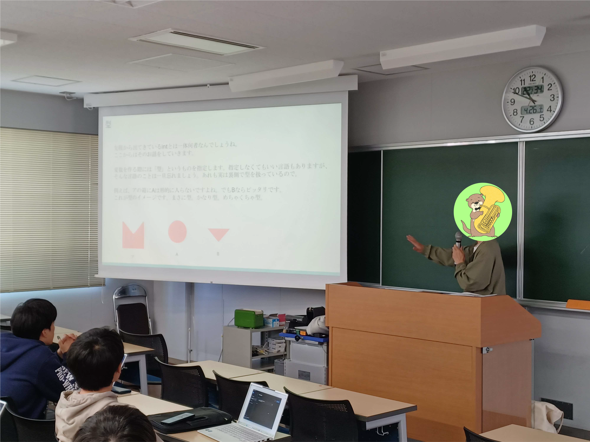
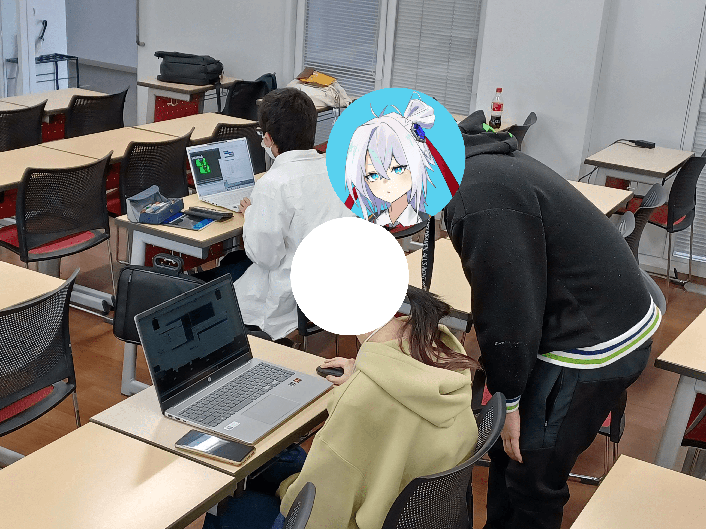
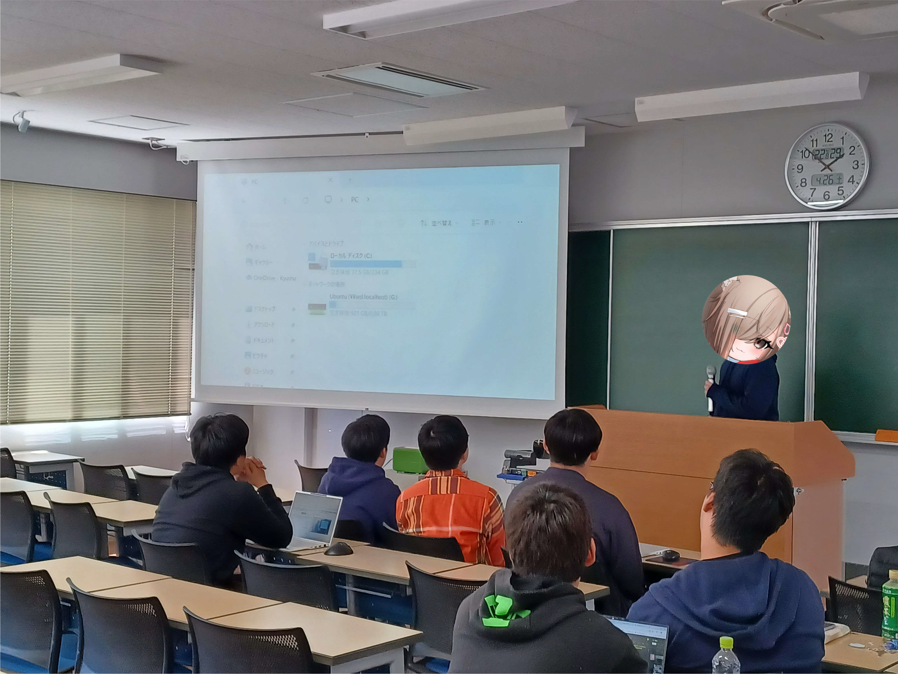
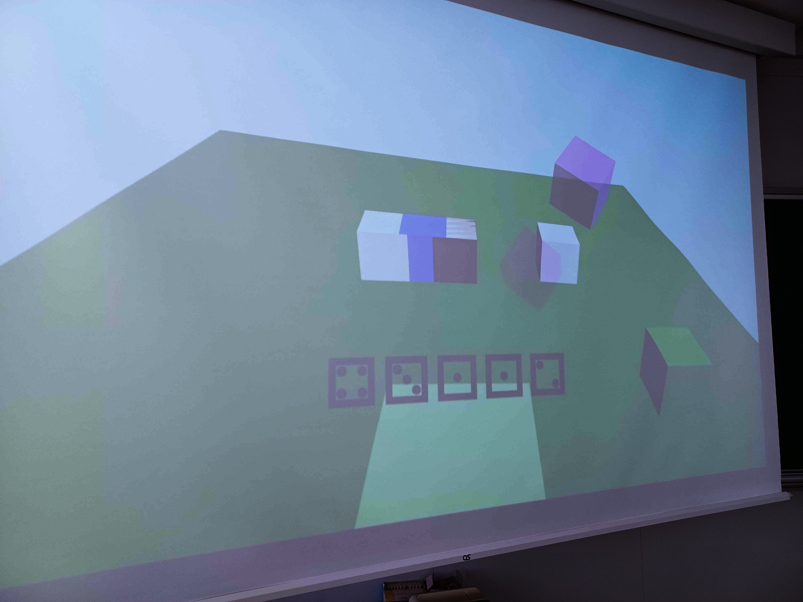
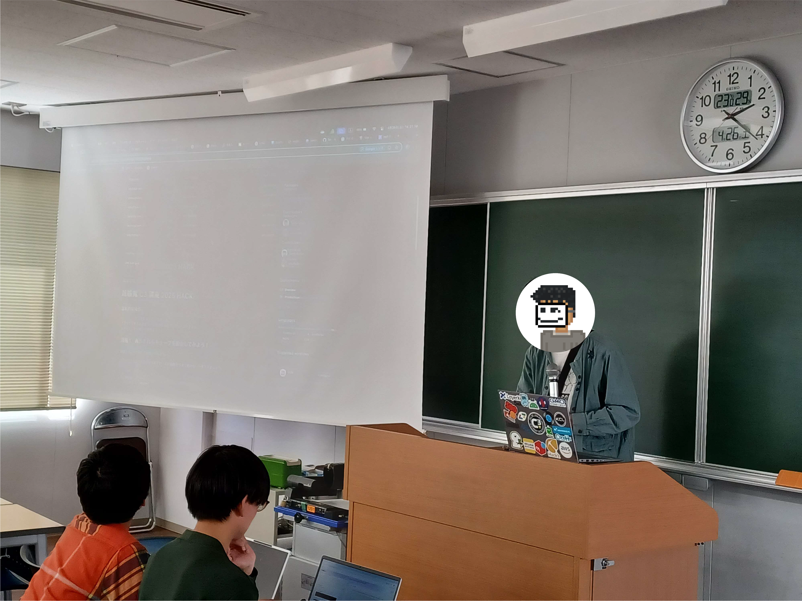
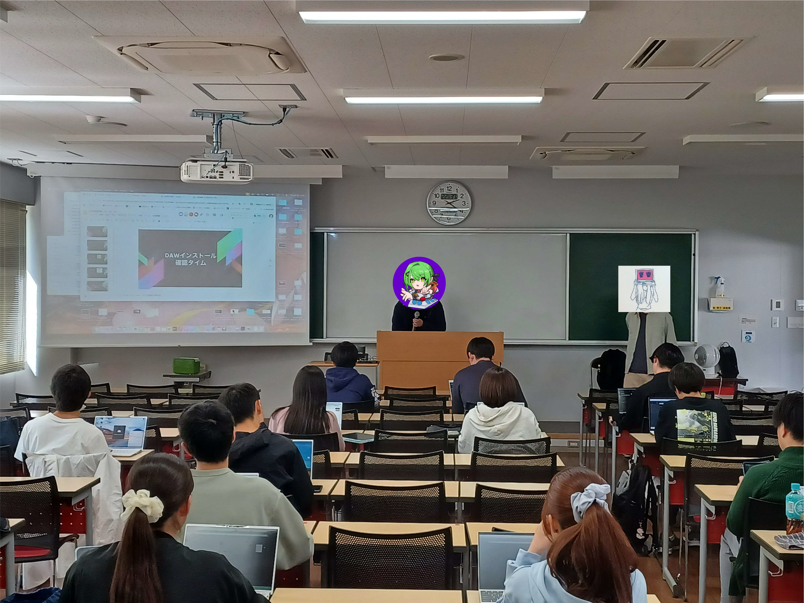

# 超感覚C3講座Day1-感想戦-

著：Snow

## はじめに
超感覚C3講座にご参加いただいた皆様、誠にありがとうございました！  
はじめてのソフトに触った人も、少しだけ触ったことがある人も、様々かと思います。  
今日の講座を通して、より興味を持っていただけたら、開催した甲斐があったなと感じます。  

という丁寧な挨拶は一旦終わりにして、  
今日一日の私視点の感想戦をゆる～くやっていきたいと思います。  
わたくし、Snowはどの講座にも顔を出したというだけで、参加はしておりませんので浅～い話になりますが、ご了承ください。

## GAME
結論から申し上げますと、OneDriveは####！！  
なにがあったか、かなり端折って説明すると、大半の皆さんのパソコンに入っておりますOneDriveに、ダウンロードしたファイルが全部入っていくという設定になっている方が多いと思います。  
それが原因で、データの一部が破損し、テクスチャが使えなくなっていたそうです。    
ノートパソコンで色々する予定がある人は、早めに切った方が良いかもしれませんね。  
私もBlenderのデータ3,4個消え失せました。気を付けましょう。  

講座担当はニコマルくんで、メンターに緑獺おがめさんの2人がかりで担当してくれました！  
講座参加者は約40名と多くの方に参加して頂きました！  
少ししか見れていませんが、プログラム的な側面と、ビジュアル的な側面を両方楽しめる面白い講座だったのではないでしょうか？  
本日参加できなかった方も、是非公開されている資料を見てチャレンジしてみましょう！
くれぐれもOneDriveに入れないように！

## 動画編集
動画編集の講座の題材はなんと**猫ミーム** ！
**古いだろ！** と突っ込みたくなるところですが、なんだかんだいって動画編集を学ぶ上で大切な機能を網羅できる良い題材だそうで、去年に引き続きニタニくんに講座担当をしてもらいました。  

流石2年目といったところでしょう。導入部分は特にゴタつきもなく、早々に導入を済ませて作業時間となりました。
私も、AviUtlは少し触ったことがありますが、1分の動画を作るだけでもかなりの時間を要しました。でも、実際に一本完成した時の達成感は凄まじいですね～。  
動画編集と言っても、様々な動画編集があります。この講座資料を読めば、あなたも動画編集がたのしくなるかも？

## Lightining Talk会
本日のLightning Talk会の発表は、  

緑獺おがめさん「キミたちはどう生きるか。」  
C＋＋をとことんオススメするLTでしたね。C＋＋愛を感じる、いわゆる推し技術LTでした。
私自身が造詣が浅いので下手なことを言えませんが、興味を持った皆さんも、C＋＋試してみてはいかがでしょうか？

tomoqさんの「『HackでCG』という選択」  
C3らしい、分野間を跨いだLTでした。人間には高次元すぎる世界のお話でしたが、それを実際に描画し、動かすのは流石tomoqさんと言ったところでしょう。数学好きな方は、お話を聞いてみると面白いかも？

私Snowの「3DCGは面白い」  
特に言うことはないですが、以前九大のQpicさんにお邪魔したときに、発表させていただいたLTを改良し、C3でも発表しました。是非CGのこと、なんでも聞いてください！

サクヤくんの「コードのあれこれLT」  
ダイナミ〇クコード最高に面白いですよね。リーダブルコードの紛らわしさは異常ですが、サクヤくんはリーダブルコードを読んでください。コード進行や音楽理論に詳しいので、そういったことに興味がある方は、是非話を聞いてみましょう。

ニタニくんの「Adobe CC を買う理由」  
Adobe高いですよね～。私は Substance Painter というAdobeソフトを使っていますが、学生認証で無料で使わせていただいております。ニタニくんの発表にあった通り、最初は無料ソフトで様子見することをおススメします。
C3にはAdobeの奴隷が何名かいらっしゃいますので、購入をお考えの方は、聞いてみると良いかもしれません。

しめさばくんの「SSDお引越し大作戦」
大半の1年生は恐らく触ることがない領域かもしれません。自作PCなどに興味がある方には、有益な情報だったのではないでしょうか？最近、デスクトップPCのお掃除もやっていたので、PC周りに強い人です。  
余談ですが、この記事を書いているタイミングで、Mastodonでバグらしきものが観測されてわちゃわちゃしてました。
いつもありがとう鯖缶!!!

## HACK
キューブたちのチャットアプリということで、小規模な空間上で、立方体が動き回って、チャットできるというアプリを実装する講座でした。いつもより自分がいじったコードに対し、視覚的なフィードバックが得られたのではないでしょうか？
私自身も、Hack分野を少しかじっていきたいと思っていたので、あとから資料でも覗いてみようかなと思っています。
Hackつよつよの先輩たちが、チャットルームを荒らしに荒らしてましたね。まさかチャットでヨットを始めるとは考えもしませんでした（笑）。

講座担当は、Semikoronくん、しめさばくん、U5くん、僕くんに担当していただきました。
鯖缶だったり、ハッカソン経験があったりと、つよつよメンツが揃っているので、わからないことがあれば聞いてみましょう！

## MUSIC
今年の講座担当はサクヤくんでメンターに緑獺おがめさん、まむさんに担当して頂きました。
DAWって？どうやって使うの？という基本操作を覚えてもらう講座でした。
元々、StudioOne Primeという無料ソフトを使用する予定だったのですが、無料版の配信がストップしてしまい急遽別のDAWソフトを使用する運びになりました。

私自身も、実は音楽を始めたくてC3に入部したという過去を持っていますが、3DCGと出会ってしまい、触ることがなかったので、卒業までに一曲くらいは作ってみたいなと思っています。  

## おわりに
改めて、本日参加してくれた皆様、ありがとうございました！  
超感覚C3講座1日目はいかがでしたでしょうか？  
明日も、2DCG,Siv3D,3DCGの講座と、Lightning Talk会 Day2がありますので、お待ちしております！