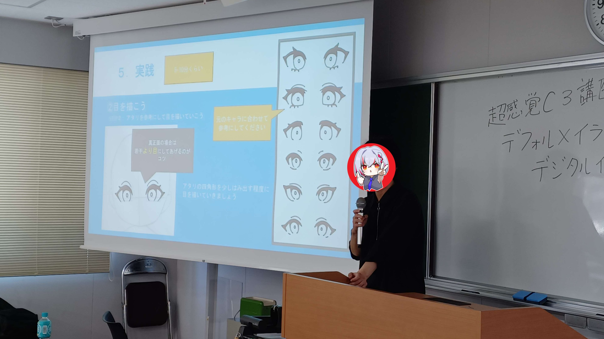
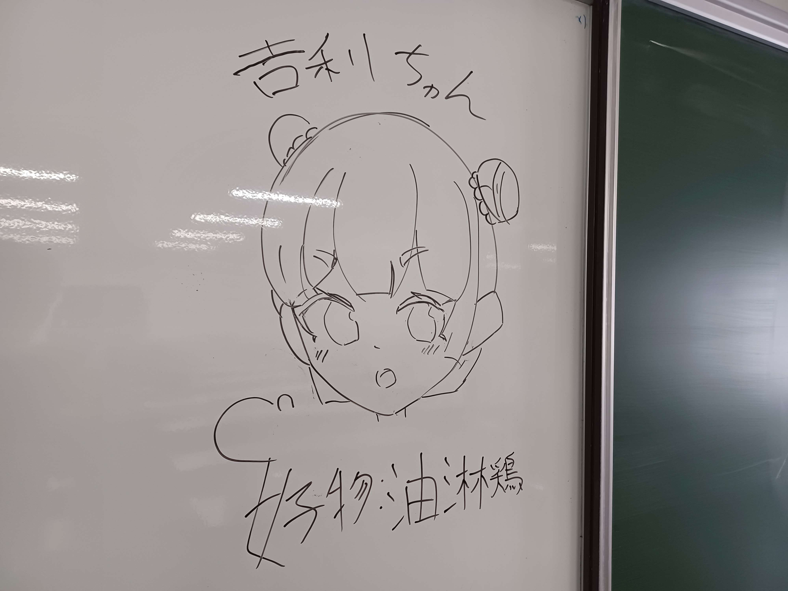
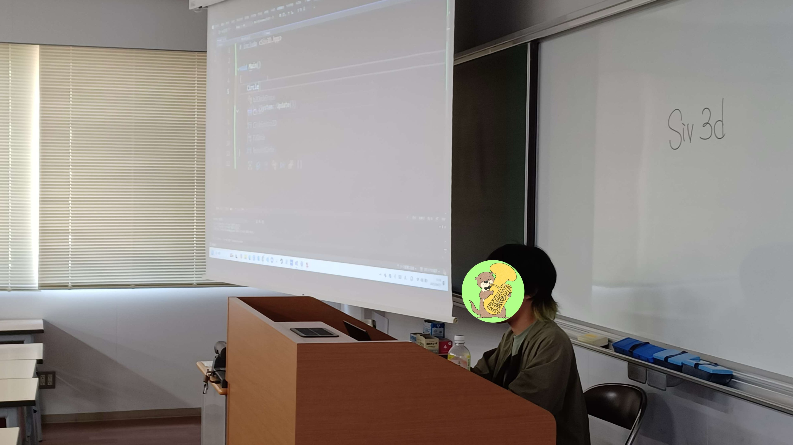
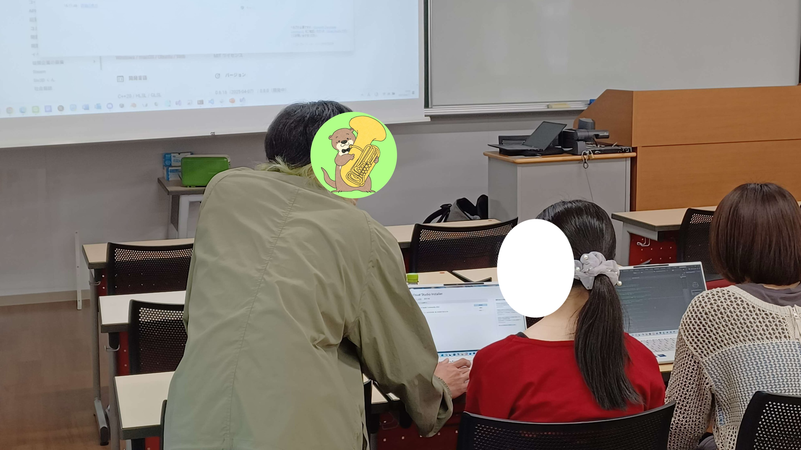
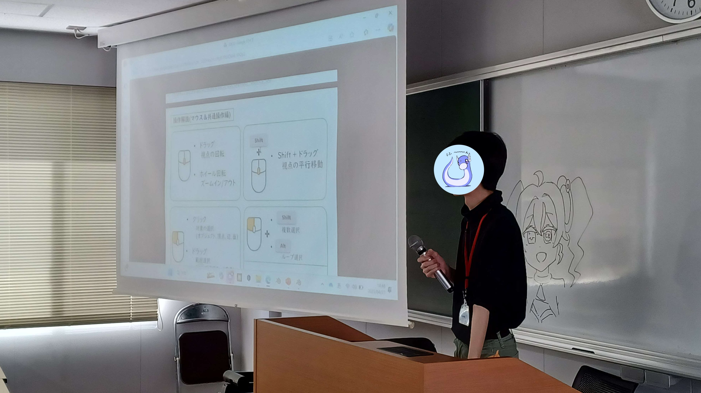

# 超感覚C3講座Day2-感想戦-

著：Snow

## はじめに
超感覚C3講座2日目の講座にご参加いただいた皆様、誠にありがとうございました！  
はじめてのソフトに触った人も、少しだけ触ったことがある人も、様々かと思います。  
今日の講座を通して、より興味を持っていただけたら、開催した甲斐があったなと感じます。

型にはまった挨拶なので、1日目と大差ないですが、本日の超感覚C3講座についても、ゆるく感想をつらつらと書いていきたいと思います。  
飯塚のネガティブキャンペーンをしたい訳ではありませんが、電車通学の九工大学生が日曜に大学に来るためには、新飯塚駅から歩かないといけないというの、なんとかならないんですかね…？

## 2DCG
講座担当は小錦くんで、メンターにMilleくん、サクヤくん、マツくんに担当してもらいました。
「デフォルメイラストで学ぶデジタルイラストのすゝめ」というタイトルで、やってもらいました。  
イラストの基礎力を鍛えるということで、ibisPaintの基本操作とキャラクターの特徴を捉えるということに重きをおいた講座でしたね。  
描くデフォルメキャラクターは、各々好きなキャラクター！
みなさん可愛いキャラクターを描いていて素晴らしかったです！

前のホワイトボードで、謎の「𠮷利ちゃん」が生まれていましたね。なんなんでしょうね？𠮷利って？

## Siv3D
またもやOneDriveに妨害を食らってしまいました。OneDrive、お前はいつも俺たちの前に立ちはだかるのか？
「Siv3Dでゲームを作ろう」というタイトルですが、まず、Siv3Dとはいったいどのようなものなのでしょうか？

Siv3Dとは  
Siv3Dは、C++でゲームやアプリを楽しく簡単に開発するためのライブラリだよ！  
との、回答をBing Copilotから頂きました。これは正しいのでしょうか？  
正しくは、C++でゲームやアプリを楽しく簡単に開発するためのフレームワークだそうです。  
AIの言うこと丸々信じるのは、絶対にやめましょう。

Siv3D講座は、司会に緑獺おがめさん、メンターにtomoqさん、Totanくんに担当してもらいました。  
Siv3dはサンプルコードなどがたくさんあり、勉強もしやすいらしい！？  
参加してくれた人たちはシンプルなクリックゲームを制作していました。

## Lightining Talk会
本日のLightning Talk会の発表は、  

私Snowの「C3chan.vrm」  
今日は、私の発表がトップバッターでしたね。特に言うこともないんですが、実際にC3ちゃんのvrmモデルを制作した話を体験談として語ってみました。いかがでしたでしょうか？

Milleくんの「電音部を知ろう！」  
「電音部」とはいったいなんなのでしょうか？
かいつまんで説明しますと、バンダイナムコが制作を手掛ける、ダンスミュージックをテーマとした音楽原作キャラクタープロジェクトだそうです！  
全士君にオススメできる作品だそうですので、興味を持った方は調べてみよう！

僕くんの「愛すべき方言たち」  
さて、C3で方言？と疑問に感じた方も多いと思いますが、なんとこのLT、Brainf＊ck における方言でした！？
Brainf＊ck で用いられる、8つの記号を別の文字に置き換えたBrainf＊ck方言となるものがあるそうで、実用性度外視のプログラミング言語として、楽しまれているそうです。  
可読性なんて一切考えない！見た目重視のプログラミング言語、面白かったです。

なんと2回目、Milleくんの「おいしい街 飯塚」  
一年生や編入生は飯塚に来たばかりということで、恐らくこのLTをしてくれたのではないでしょうか？
飯塚の料理屋の紹介を沢山してくれました。（中には田川市や鳥栖市にあるものも含まれておりましたが…？）
私が良く行くお店も、紹介されていました(田川のお店)。興味が湧いたら自分で行ってみたり、車持ちの人を捕まえて連れて行ってもらいましょう！

サクヤくんの「過去の栄光吉利について」  
吉利？吉利ってなんですかね…？  
大学隣にできた”大連”という台湾料理屋、実は1年ちょっと前まで”吉利”という名前のお店で、C3部員御用達のお店でしたが、一年ほど前にリニューアルし“牡丹苑”という名のお店に変わりまして、最近またリニューアルしました。  
大連は恐らく、C3部員御用達になるのではないでしょうか…？

## 3DCG
最後の時間の講座は私Snowが担当した「Blenderの初歩」。  
基本操作を楽しく覚える！を理念に制作した資料どもどもはいかがでしたでしょうか？  
昨年とほぼ同じ内容で講座をさせていただきました。感触としましては、今年の参加者はパソコン慣れしてるのか、案外スルスルと自力で、進めてくれていて驚きました。  
メンターを、無糖さん、Rihakuくん、エフネコくんに担当してもらいました。ありがとう！

さて、ルリリを知らない1年生が居ましたね～。ジェネギャでしょうか…(泣)
カービィに戻して、フォルムチェンジで差分作ってみるのもありかもなぁ（独り言）

## おわりに
さて、超感覚C3講座が終了して、ちょうど1週間経ってしまいました。  
はい。とっても遅くなってしまいました…  
色々と忙しくて…  
超感覚C3講座2日間通していかがでしたでしょうか？私はかなり満足のいく感じで終われました。  
この記事を見ている、1,2年生の皆さん！来年は、講師側にあなたが立っているかもしれませんね～。  
是非、これを機会に色んなものに挑戦してみてください！
#### 創作は着手です！