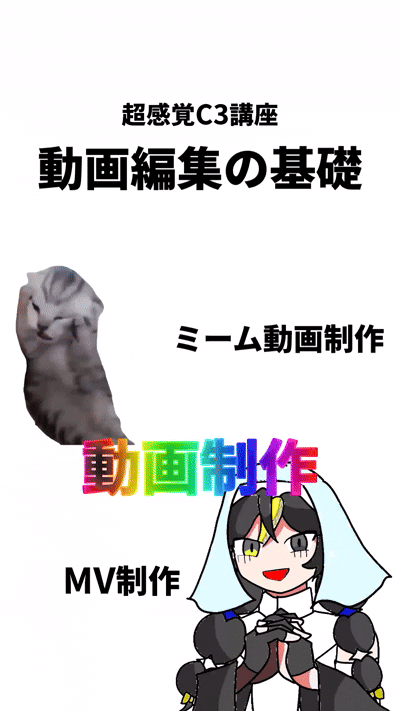
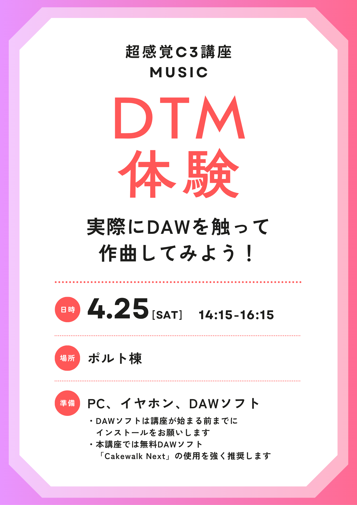
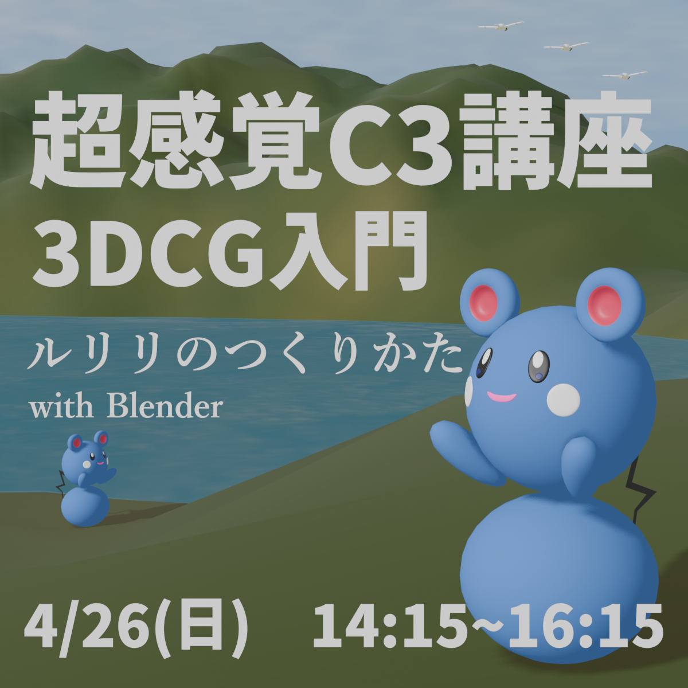
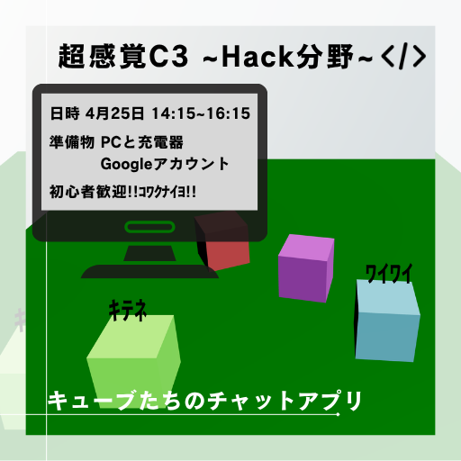
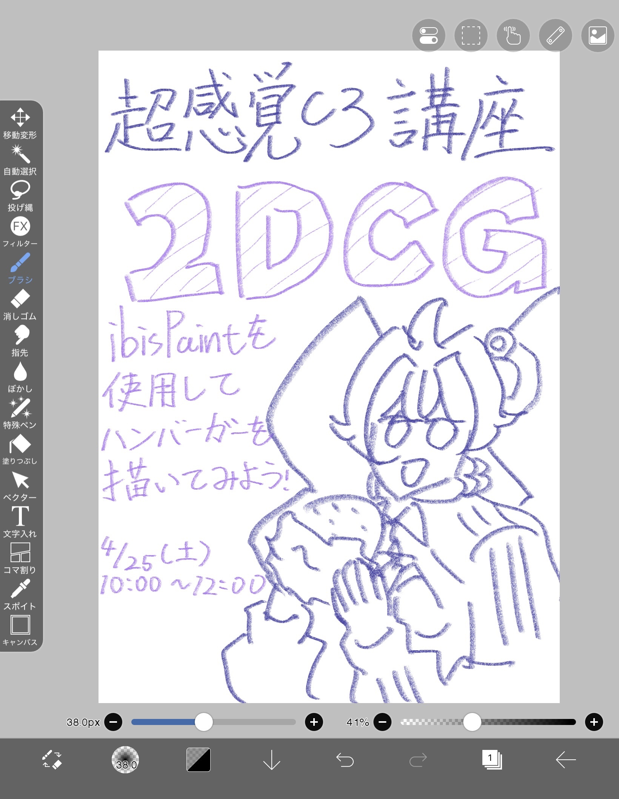
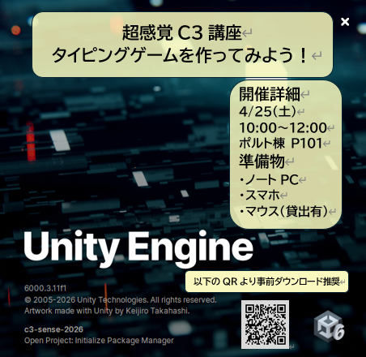

# 超感覚C3講座 今年も開講！！！
去年に引き続き、今年も超感覚C3講座が開講されることになりました！！

簡単に超感覚C3講座について説明すると、C3内でのゲーム、イラスト、音楽などの製作を実際に体験することが出来る講座になっています！

今回開講される講座もすべて魅力的な講座になっていて、まだ何もしたことない人が創作活動を始めるのにぴったりの内容となっています！！！

# 開催日時
### 4/25(土),26(日)に ポルト棟 で開催決定！！

4/25(土)の日程

10:00~12:00 GAME 2DCG

13:00~14:00 Lightning Talk会 Day1

14:15~16:15 HACK MUSIC

4/26(日)の日程
10:00~12:00 動画編集

13:00~14:00 Lightning Talk会 Day2

14:15~16:15 3DCG

# 開催講座の詳細
### 動画編集「動画編集の基礎」
紹介：　「動画編集してる」って言ってみたいですよね？ネットミーム・ボカロMV制作を通じて動画編集の基礎を学んでみましょう！ 

時間：4/26(日)10:00~12:00

持ち物：PC、マウス、充電器

### MUSIC「DTM体験」
紹介：　難しい音楽理論の知識は不要！実践的な講座を通してイチから作曲してみませんか？

時間：4/25(土)14:15~16:15

持ち物：PC、イヤホン、DAWソフト ※DAWソフト「Cakewalk next」は事前ダウンロード推奨

<https://www.cakewalk.com/next> ←ダウンロードはこちらから！

### 3DCG「3DCG入門～ルリリの作り方～」
紹介：初心者大歓迎！！！無料ソフトのblenderで、はじめての3Dモデルを作ってみませんか？

時間：4/26(日)14:15~16:15

持ち物：ノートパソコン、マウス、スマホorタブレット

### HACK「キューブたちのチャットアプリ」
紹　介：プログラミングのことよく知らないけど実践的なことがしてみたいそこのあなた！この講座でWebアプリの制作をゆるーく体験してみよう！

時　間：　4/25(土)14:15〜16:15

準備物：　ノートPC、PCの充電器

### 2DCG「ハンバーガーを描くよ」

紹介：初心者向けにイラストの描き方を教えます．今回は複雑な人体を描かず代わりにハンバーガーを描くため，より初心者向けになってます！経験者向けに別途で1.5時間ドローイングをする機会を設けているため，経験者も大歓迎！

時間：4/25(土)10:00~12:00

持ち物：ibisPaintXがインストールできる端末(スマートフォンやタブレットがあればOK)
※自前でペイントソフトを持っている人がいる人はそちらを使ってもらって構いません

### GAME「タイピングゲームを作ってみよう」

紹介：初めての方でも作れます！経験者向けの追加内容もあるのでぜひ！
　　　今回は出てきたキーを素早くタイピングするゲームを作ります

時間：　25日　10:00~12:00

準備物：　ノートPC、スマホ、マウス（貸出有）

※アプリの事前ダウンロードを推奨しています！詳しくはこちらから

<https://compositecomputer.club/blog/3c6ee14f-2968-48bf-b71a-f00cb16f3a91>

# 参加方法
下のフォームを記入すれば準備は完了！
<https://docs.google.com/forms/d/e/1FAIpQLSddGV6IA1rMLLx9b_MmX4-M5dLxrwFwCvAUlU8kbBOg91EXJg/viewform?usp=dialog>