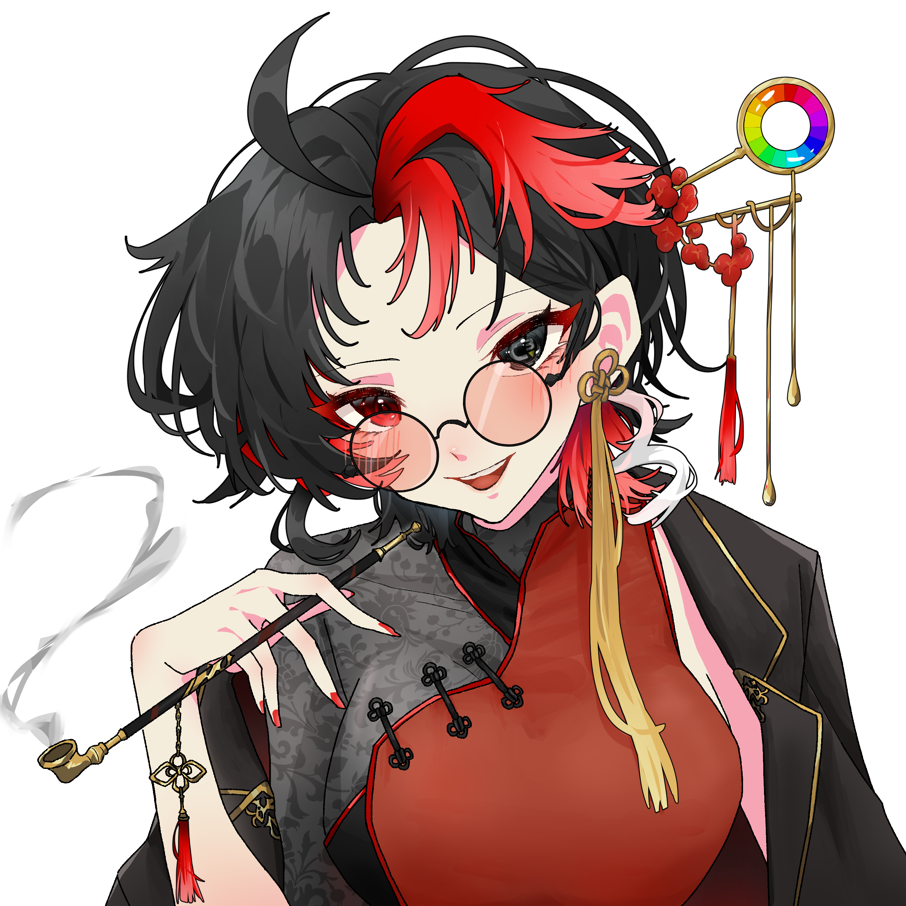
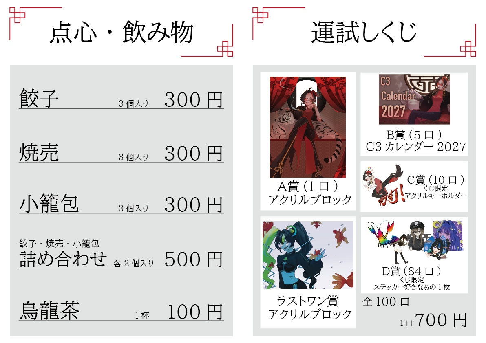
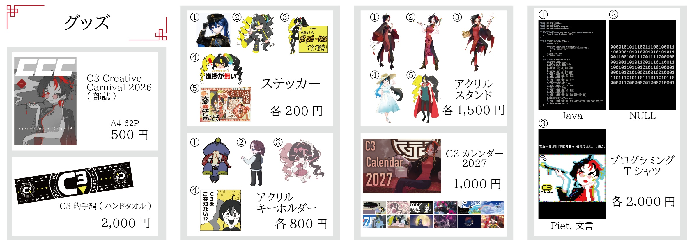

# はじめに
HPではお久しぶりです。部長のMilleです。先日誕生日を迎えました。  
10月10日(土)～10月11日(日)に、工大祭が開催されます！  
C3も工大祭に参加しており、サークル展示や模擬店を運営します。  
本記事では、今年度の工大祭のC3の見せ所を紹介できればなと思います！  

# テーマ
今年度のC3テーマは、「**C3 China City ～C3中華街～**」です！    
2023年度からコンセプトカフェをベースにして、メイド→茶屋→シスターときて今年度は中華になりました。今年のテーマカラーは赤なので、ちょうどいい感じです！  
C3は[どうしてか](https://toybox.compositecomputer.club/works/9f3481ed-c09b-46be-9941-f0dc8f20e98b)並々ならぬ中華(料理)に対する意識があるので、今年度はかなり盛り上がっている印象です。  

合わせて、応援隊長C3ちゃんもイメチェンしています！  
いつもの活発な雰囲気とは一風変わって、スタイリッシュな仕上がりとなりました。  

# 模擬店
今年度の模擬店では点心を提供します！  
点心とは、中華料理における軽食の総称です。模擬店では、餃子や焼売、小籠包を販売します。飲み物として烏龍茶も販売しています。ぜひ模擬店に訪れて、飲茶を楽しみましょう！  

また、例年同様グッズの販売もします！  
今年の部誌はここ数年で最も厚みのある仕上がりとなっており、かなりボリューミーです！  
昨年度大好評だった(？)運試しくじも続投です。今年のA賞・ラストワン賞は、なんと**アクリルブロック**です！  
他の賞にもくじ限定の商品がございますので、ぜひ運試しをしてみてください！  
模擬店の場所は**第二グラウンド**で、C3はグラウンドに入って右手側のテントで店を構えています。C3ちゃんの等身大パネルが特徴です！  

# サークル展示
サークル展示は講義棟内で行われます。今年のC3の展示は**1202講義室**です。  
サークル展示では、過去の工大祭で販売したグッズや部誌の展示や、リアルタイムで創作をする部員を眺めることができるC3動物園があります。  
また、3Dプリンターがずっと稼働するスペースや、有志の部員が作ったゲームなどの体験をするスペースもあります！  

# あとがき
筆者はグッズのデザインのために夏季休業の1/3ほどが無くなったので、ぜひグッズを買ってください！お願いします！