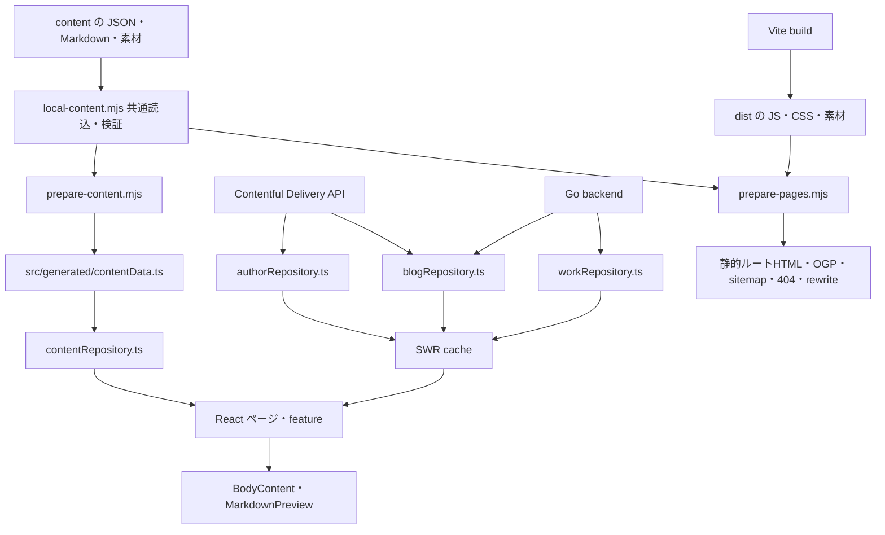

# 現在の構成とデータの流れ

この文書は現在の `src/`・`content/`・`scripts/` の実装を説明します。旧NuxtサイトやToybox本体の設計とは分けて扱います。外部サービスの接続・本番配信の確認結果は [レビューと検証記録](review.md) を参照してください。

## 全体像

C3公式サイトはVite + React + TypeScriptのSPAです。独自のAPIサーバーや認証・投稿機能は持ちません。紹介・分野・お知らせをビルド時に取り込み、著者・ブログ・掲載作品をブラウザから外部APIへ取得します。React Routerが画面を切り替え、SWRが外部取得のキャッシュ・再取得・エラー状態を管理します。

## ディレクトリの責務

| 場所 | 内容 |
| --- | --- |
| `content/site/index.json` | サイト名・説明・canonical origin・作品サイトURL・分野表示順・外部リンク |
| `content/about/` | C3紹介の設定・Markdown本文・素材 |
| `content/communities/<slug>/` | 分野ごとの設定・本文・MP4紹介動画。slugはgame / 3dcg / hack / 2dcg / music |
| `content/news/<folder>/` | お知らせの設定・本文・素材。フォルダ名と公開IDは別に扱う |
| `content/tags.json` | ローカルお知らせのタグ。外部ブログのタグは各APIが返すものを使う |
| `src/main.tsx` | テーマ初期化・React root・StrictMode・BrowserRouter |
| `src/App.tsx` | ルートとページのlazy import |
| `src/pages/` | URL・検索条件の受け取り、取得状態の分岐、featureの組み合わせ |
| `src/features/` | Header・記事カード・記事詳細・作品欄・Markdown表示などの機能 |
| `src/shared/ui/` | Button・Dialog・Paper・Toast・パンくず・メタ情報などの共通部品 |
| `src/shared/types/content.ts` | 内部のAuthor / Entry / BlogEntry / Community / FeaturedWork型 |
| `src/util/` | API境界・データ変換・テーマ・スクロール固定・日付表示 |
| `src/assets/` | UIで共有するロゴ・アイコン・動画poster |
| `src/generated/` | コンテンツ生成物。Git管理外で手動編集しない |
| `scripts/` | コンテンツ生成・記事ひな形作成・配信HTML生成・各種検証 |
| `.storybook/` | UI確認・操作テスト・テーマ・a11yの設定 |
| `.github/workflows/ci.yaml` | PR / push時の依存導入と `npm run ci` |

CSSは各コンポーネントの `index.module.css` が所有し、全体の色・寸法は `src/index.css` の変数へ集約します。

## ルートと表示

| URL | ページ / 主な機能 | データ元 |
| --- | --- | --- |
| `/` | TopPage → HomeHero / HomeCommunity / HomeBlog / FeaturedWorks | ローカル + 外部ブログ・作品API |
| `/about` | AboutPage → Paper / BodyContent / CommunityLinks / FeaturedWorks | ローカル + 作品API |
| `/community/:slug` | CommunityPage → MP4 / Paper / BodyContent | ローカル |
| `/news` | NewsPage → EntryCard一覧 | ローカル公開お知らせ |
| `/news/:id` | NewsDetailPage → EntryDetail | ローカル公開お知らせ |
| `/blog` | BlogPage → BlogStatus / EntryCard一覧 | Contentful + Go経由の外部ブログ |
| `/blog/:id` | BlogDetailPage → BlogStatus / EntryDetail | ID形式に応じたブログAPI |
| `/author/:id` | AuthorPage → AuthorProfile / EntryCard一覧 | Contentful著者・その著者のブログ |
| その他 | NotFoundPage | 404表示 |

一覧の `?tag=` はタグ名でクライアント内絞り込みを行います。ブログ詳細は `/blog/:id` に統一し、UUIDはToybox、それ以外のIDはContentfulから取得します。両サービスのIDは重複しない前提です。取得元のクエリ指定は使用しません。旧分野ID、`/contact`、`/contact/thanks` は現在のルートにはありません。

`AppLayout` はヘッダー・フッター・本文へのスキップリンク・Suspenseを提供します。ページのlazy import待ちでも共通レイアウトを維持します。ハッシュなしのページ遷移では先頭へ移動し、Markdownの見出しハッシュは本文読込後に復元します。

## ローカルコンテンツの生成

1. `prepare-content.mjs` と `prepare-pages.mjs` が共通の `local-content.mjs` を使って `content/` のフォルダを探索し、JSONを読み込みます。
2. `local-content.mjs` がID / slug・タグIDの形式と重複、お知らせの必須値・タイムゾーン付き日時・更新日時の前後関係・著者ID配列・タグ参照、分野の表示順、参照ファイルの範囲・存在・25 MiB上限を検査します。著者IDがContentfulに実在するかは確認しません。
3. `content/news/` の全記事を公開データへ含め、作成日時の新しい順、同時刻はID順に並べます。公開・重要フラグと下書き機能はありません。ホームの「重要なお知らせ」も全ニュースを使います。
4. `./assets/...` はViteの `?url` importへ、本文は `?raw` の動的importへ変換します。共通接頭辞のある素材名は長い参照から置換し、URLの一部だけが置換されるのを防ぎます。
5. `src/generated/contentData.ts` を出力し、`contentRepository.ts` が検索関数と `CONTENT` を公開します。

本文は `BodyLoader = () => Promise<string>` です。`BodyContent` の `useBody` が読込中・失敗・再試行を管理し、古いリクエストやアンマウント後の結果を表示に反映しません。ブラウザで取得するブログ本文も、この関数型へ揃えます。

`predev` / `prebuild` / `prestorybook` / `prebuild-storybook` が起動前に生成します。Viteプラグインは開発中の `content/` 変更を監視し、再生成します。`ci`では型チェック等に先立って生成し、buildのprehookでも生成するため、生成処理は2回走ります。

## APIと変換

| 用途 | 接続先と主要条件 | 内部の入口 |
| --- | --- | --- |
| 著者1人 | Contentful `/spaces/{space}/environments/master/entries?content_type=user&sys.id={id}&include=1&limit=100` | `getAuthor` |
| 著者一覧 | 同上、`skip`で全ページ取得 | `getAuthors`（現在のページから直接は使用しない） |
| ブログ一覧 | Contentful entries、`content_type=blog&include=2&order=-sys.createdAt`、selectで本文を除外、limit=100 / skipで全件取得 | `getBlogs` |
| Contentfulブログ詳細 | `sys.id`・limit=1を指定、selectによる本文除外は行わない | `getBlog` |
| 著者別ブログ | 一覧条件に `fields.user.sys.id` を指定、本文を除いた全件取得 | `getAuthorBlogs` |
| 外部ブログ一覧 | Go backend `GET /api/v1/blogs?disable_pagination=true` | `getBlogs` |
| 外部ブログ詳細 | Go backend `GET /api/v1/blogs/{id}` | `getBlog` |
| 掲載作品 | Go backend `GET /works?limit=20&page=1&sort=newest&visibility=public` | `getPublicWorks` |

Contentfulには公開用DeliveryトークンをAuthorization headerで渡します。Go側の公開GETは `credentials: "omit"` で取得します。Goのブログ転送にはbackend側の `LEGACY_TOYBOX_BASE_URL` が必要です。このリポジトリにはbackendや同一originプロキシを実装していません。

`blogRepository.ts` はContentfulの `sys` / `fields` / `includes` と、外部ブログの `body_text` / `created_at` / `updated_at` / `user` を `BlogEntry` へ変換します。外部ブログの公開日時が作成・更新日時より後なら公開日時を優先します。Contentfulの `//...` 形式の素材URLはHTTPSに補完します。

`workRepository.ts` は `works` 配列を確認し、必要な型・`visibility: public` を満たす項目だけを最大20件へ制限して `FeaturedWork` に変換します。ブログと作品は同じAPIベースURLを使いますが、レスポンス形式は共通ではありません。

外部ブログの著者はレスポンス内の情報を表示し、作品サイトの著者ページへリンクします。Contentful著者IDとして再検索しません。Contentful記事・ローカルお知らせの著者は `AuthorBadge` がContentfulから取得します。

## キャッシュ・識別・失敗時の動作

| データ | SWR key / 状態 |
| --- | --- |
| ブログ一覧 | `"blogs"`。ホーム・ブログ一覧・最近の記事で共有。ホームは取得結果の先頭5件を表示 |
| ブログ詳細 | `["blog", id]` |
| 著者 | `["author", id]`。著者バッジと著者ページで共有 |
| 著者別ブログ | `["author-blogs", id]`。著者取得成功後に全件取得 |
| 公開作品 | `["public-works", API_BASE_URL, WORKS_LIMIT]`。ホームとAboutで共有 |

ブログの識別・React key・最近の記事からの除外・URLはIDだけを使います。内部の `source` は著者の表示方法など、取得元に応じた変換に使用します。

一覧はContentfulと外部ブログを並行取得します。一方だけ失敗すると成功側を表示し、部分失敗と再試行を出します。両方失敗するとエラー、成功した空配列は正常な0件です。取得失敗を404として扱いません。

詳細はID形式で取得先を決め、そのサービスで不在なら404画面、取得失敗なら通信エラーを表示します。別サービスへのフォールバックは行いません。

ブログ・著者別一覧の全件取得は維持し、追加読込のUIは設けません。タグは取得済みの全記事を絞り込みます。

Contentful一覧はselectで本文を取得対象から外し、詳細表示時に取得します。Toybox一覧APIは本文を必ず返すため、既存の全件取得を維持します。フロントでは表示用概要を200文字に制限しますが、本文の転送量を削減するものではありません。Toyboxの本文転送の削減にはAPI側の対応が必要です。

自動エラー再試行は抑え、各画面に再試行操作があります。SWRの通常のキャッシュ共有・再検証は維持します。紹介・お知らせの本文は外部ブログの通信障害に依存しません。

## Markdown・島レイアウト・テーマ

C3紹介、分野、記事詳細は共通の `Paper` を使い、`--paper-color`、角丸、影、内側余白を揃えます。外枠は `--content-read-width: 1300px` を上限とし、左右余白は通常32px、599px以下で16pxです。Paperの内側は通常40px、スマホ16px。お知らせ詳細はこの外枠内に本文と300pxのサイドバーを配置し、1000px以下で縦並びにします。ブログ詳細は画面幅によらず本文の下に最近のブログを配置します。

`MarkdownPreview` はGFM・数式・改行・raw HTMLを解析し、sanitize後にKaTeXや見出しリンクなどを組み立てます。script / iframe / SVG等を除外し、URLのprotocol制限・ID衝突対策を維持します。許可した色・文字サイズ・画像幅だけを装飾として扱います。画像拡大は共通Dialog、コードコピーはToastを使用します。

コード・引用・表見出し等は `--background-color` を使い、Paperの背景と区別します。`details`と表本体には背景を固定しません。画像拡大／メニューは `lockPageScroll` と対応CSSで背景を固定し、閉じたときにスクロール位置を戻します。

テーマは `data-theme` を介してCSS変数を切り替えます。起動時はlocalStorageの保存値を優先し、未保存ならOS設定、取得不可ならライトです。変更は保存・他タブへ同期します。`prefers-reduced-motion` による表示分岐は現在ありません。

## ビルド後の配信

`npm run build` はコンテンツ生成 → TypeScript → Vite → `prepare-pages.mjs` の順です。postbuildは `local-content.mjs` の共通読込・検証結果から静的ルートごとのHTMLにtitle・description・OGP・canonicalを埋め込み、OGP画像・sitemap・robots・404・`_redirects` を生成します。静的ルート数は `content/news/` の全記事と分野の件数に応じて変わります。

HTMLのtitleは全ページで `ページ名 | C3` に統一し、トップページは `Composite Computer Club | C3` とします。`PageMeta` はブラウザ内遷移後のtitle・OGP・canonicalを更新し、404には `noindex`、通常ページへの復帰時には解除します。クライアントの更新だけで、ブログ詳細・著者の初期HTMLに個別OGPが付くわけではありません。

Cloudflare向けrewriteは `/blog/*` と `/author/*` のSPA表示用です。未知の動的IDを画面で404にしてもHTTPステータスは200です。動的詳細の初期OGP・sitemap・HTTP404は残課題です。`preview:pages` は静的配信のローカルモデルで、本番環境を再現するものではありません。

## 環境変数と検証の入口

- `VITE_CTF_SPACE_ID`：Contentful space。
- `VITE_CTF_CDA_ACCESS_TOKEN`：公開可能なDeliveryトークン。
- `VITE_API_BASE_URL`：Go backendのベースURL。`/works`・`/api/v1`を含めません。
- `SITE_URL`：コンテンツ生成とpostbuildのcanonical originを共通で上書きするビルド用設定。省略時は `content/site/index.json`。`SITE_URL=https://example.com npm run build` のように同じビルド全体へ渡します。確定したoriginは生成データにも含め、画面遷移後も維持します。

`VITE_*` はブラウザ配信に含まれます。実値や管理用・Previewトークンは文書・テンプレートに保存しません。Vite環境変数を変更したときは開発サーバーの再起動、公開用には再ビルドが必要です。

日常の検証は [開発環境とCI](development-and-ci.md)、content編集は [コンテンツ構成](content-structure.md)、公開前の確認は [Cloudflare Pages](cloudflare-pages.md) を参照してください。
