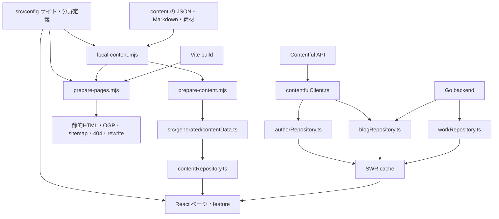

# 現在の構成とデータの流れ

Vite + React + TypeScriptのSPAです。紹介・分野・ニュースをビルド時に取り込み、ブログ・著者・掲載作品を外部APIから取得します。独自のAPIサーバー・認証・投稿機能は持ちません。実サービス・本番の確認範囲は [検証記録](review.md) を参照してください。

## 設定とコンテンツ

| 場所 | 責務 |
| --- | --- |
| `src/config/site.ts` | サイト名・説明・公開origin・既定OGP画像・固定ページ名・外部リンク |
| `src/util/pageMetadata.ts` | HTML生成とReactで共有するタイトル・canonical・OGPの値の生成 |
| `src/config/communities.ts` | 分野のslug・名称・表示順。Aboutのリンク順は用途を分けて明示 |
| `content/about/` | 概要・Markdown本文・素材 |
| `content/communities/<slug>/` | 紹介文・動画・Markdown本文・素材。slugはフォルダ名で設定コードと対応 |
| `content/news/<folder>/` | 記事ID・タイトル・概要・投稿日・Markdown本文・画像 |
| `src/features/CommunityIcon/` | 分野slugに対応する共通アイコン |
| `src/features/ExternalLinkIcon/` | 外部リンクの安定したキーに対応する共通アイコン |
| `src/generated/` | Git管理外のコンテンツ生成物。手動編集しない |
| `public/C3Logo.svg` | C3ロゴの元画像。画面では `SITE.logo` から参照 |
| `public/` のPNG・ICO・manifest | 同じSVGから `icons:generate` で生成するブラウザ・端末用アイコン |
| `src/assets/` | その他の共通アイコン・動画poster |

公開originは `SITE.origin` の固定値です。環境変数による上書きは行いません。HeaderとFooterの外部URLは共通定義を参照し、表示ラベルも共通化し、順序はそれぞれに指定できます。ナビゲーション・固定ページ・配信用HTMLは `PAGE_TITLES` のページ名を参照します。トップページ名は `SITE.title` を使います。ルートとリンク先は利用箇所に直接記述し、Header・Footerの外部リンクの表示順も各コンポーネント内で管理します。

## 生成と表示

1. `local-content.mjs` が記事・分野・紹介ページを読み込みます。ニュースのID重複・必須値・実在する投稿日（YYYY-MM-DD）、素材の範囲・存在・25 MiB上限を検査します。分野フォルダはコード側の定義と過不足なく対応させます。ニュースはContentfulの著者に依存しません。
2. ニュースは全件を公開対象とし、投稿日 `publishedDate` の降順、同日はID順で並べます。タグ・公開フラグ・重要フラグ・下書き機能はありません。ホームは最新5件を表示します。
3. `prepare-content.mjs` が紹介・分野・ニュースごとに出力項目を明示して変換します。本文は `bodyLoader`、ニュース画像・分野動画は `assetReference` で処理します。その他の文字列をプロパティ名や接頭辞から素材と推測することはありません。
4. 本文中の `./assets/...` は参照を解決してViteの素材URLへ置き換えます。同じ接頭辞を持つ名前は長い順に置換します。本文は `?raw` の遅延import、素材は `?url` のimportにします。
5. `contentRepository.ts` が `CONTENT` と記事・分野の検索関数を公開します。

`predev` / `prebuild` / `prestorybook` / `prebuild-storybook` が生成を実行します。Viteは開発中の `content/` 変更を監視します。`ci`と`prebuild`の両方で生成するため、CIコマンドでは2回走ります。

## 記事型と表示部品

`EntrySummary` は `NewsSummary | BlogSummary`、`Entry` は `NewsEntry | BlogEntry` です。詳細型だけが `BodyLoader = () => Promise<string>` を追加し、記事自身の `kind` で表示を切り替えます。

- ニュースは `publishedDate` の日付だけを持ち、「投稿日：YYYY/MM/DD」と表示します。作成日時・更新日時・著者・タグは持ちません。
- ブログは作成・更新日時、著者参照・タグ・取得元を持ちます。著者は `{ id, profile }`、タグは `{ id, name }` に取得境界で揃えます。
- EntryCard・Carouselは一覧型だけを使い、EntryDetailだけが本文を要求します。ニュース表示から著者APIを呼びません。
- 表示部品はニュースとブログの項目の違いを扱い、ブログの取得元ごとの変換は行いません。AuthorBadgeは著者情報が不足する場合だけ共通の著者キャッシュを参照します。

`BodyContent` の `useBody` が本文の読込中・失敗・再試行を管理し、古いリクエストやアンマウント後の結果を反映しません。

記事一覧は `EntryGrid` をニュース・ブログ・著者ページで共用します。PCでは248px以上のカードを並べ、画像枠は4:3、タイトルは2行、概要（`digest`）は2行の領域を確保します。599px以下は画像36%の横型カードに切り替え、概要は2行にします。タグは同様にタイトルの前へ配置し、スマホでは画像右側の本文欄の先頭に表示します。概要が空でも画像枠・カード高・メタ情報位置は変わりません。画像の読込中・未設定・読込失敗でも枠を保持し、未設定・失敗時は画像アイコンを表示します。

 `Batch` と `TagLinkList` を使用し、角丸・余白・太字・primaryの内枠と薄い背景を揃えます。一覧・カルーセルは小さいタグ、詳細は標準サイズで折り返して表示します。色はこのサイトのprimaryを参照します。

記事詳細は画像の後へタイトル・タグ・日時・著者を配置し、概要もheaderにまとめ、区切り線の後に本文を配置します。概要は空でない場合だけ表示し、記事の内側の幅に沿って自然に折り返します。カードと詳細の著者欄にはToyboxから取り込んだ `UserButton` と `Avatar` を使います。一覧はcompact（アバター24px、599px以下は22px）、詳細は標準（アバター36px）です。アバター未設定・読込失敗時は人物アイコンを表示します。Contentful著者はサイト内の著者ページ、Toybox著者は外部のユーザーページへリンクします。投稿・更新日時にはアイコンとtime要素を使い、一覧は投稿日だけを表示し、更新日は表示しません。日付ラベルは読み上げ用に残し、画面ではアイコンと日付で表します。詳細では時刻も表示し、ニュースは引き続き投稿日だけを表示します。

## ルート

| URL | 表示・データ元 |
| --- | --- |
| `/` | ローカル紹介・分野・ニュース、外部ブログ・作品 |
| `/about` | ローカル紹介、分野リンク、外部作品 |
| `/community/:slug` | ローカル分野本文・紹介動画 |
| `/news`・`/news/:id` | 全ローカルニュースの一覧・詳細。タグ絞り込みなし |
| `/blog` | ContentfulとToyboxのブログ一覧。`?tag=` はタグ名でクライアント内絞り込み |
| `/blog/:id` | UUIDはToybox、それ以外のIDはContentful。取得元クエリは不要 |
| `/author/:id` | Contentfulの著者プロフィール・著者別ブログ |
| その他 | 404画面 |

ブログのIDは取得元間で重複しない前提です。URL・React key・最近の記事からの除外はIDだけを使います。対象サービスで不在なら404、取得失敗なら通信エラーを表示し、他サービスへフォールバックしません。旧分野ID・contactのルートはありません。

## API境界とキャッシュ

`contentfulClient.ts` が接続先・Deliveryトークン・HTTPエラー・コレクションの形・全件取得の進捗を共通管理します。`authorRepository.ts` と `blogRepository.ts` は各コンテンツの変換を担当します。Contentful素材の `//...` URLはHTTPSへ補完します。

| 用途 | API・条件 |
| --- | --- |
| 著者一覧 | Contentful `content_type=user&include=1`。100件ずつ全件取得 |
| ブログ一覧 | Contentful `content_type=blog&include=2&order=-sys.createdAt`。selectで本文を除外し100件ずつ全件取得 |
| Contentfulブログ詳細 | `sys.id`・limit=1を指定。本文も取得 |
| 著者別ブログ | 一覧条件に `fields.user.sys.id` を指定 |
| Toyboxブログ一覧 | Go経由 `GET /api/v1/blogs?disable_pagination=true` |
| Toyboxブログ詳細 | Go経由 `GET /api/v1/blogs/{id}` |
| 公開作品 | Go `GET /works?limit=20&page=1&sort=newest&visibility=public` |

| データ | SWR key・動作 |
| --- | --- |
| ブログ一覧 | `"blogs"`。ホーム・一覧・最近の記事で共有 |
| ブログ詳細 | `["blog", id]` |
| 著者一覧 | `"authors"`。`useAuthors` をバッジ・著者ページで共用。immutableキャッシュで保持し、再試行時に更新 |
| 著者別ブログ | `["author-blogs", id]`。著者確認後に取得 |
| 公開作品 | `["public-works", API_BASE_URL, WORKS_LIMIT]`。ホーム・Aboutで共有 |

ブログ一覧の独立した取得は並行実行し、一方の失敗なら成功分と部分失敗を、両方の失敗ならエラーを表示します。成功した空配列・不在・通信失敗を区別し、自動エラー再試行を抑えて再試行ボタンを用意します。

Contentfulのブログ一覧に含まれる著者はそのまま表示し、追加の著者通信を行いません。ブログ内の不足する著者・著者ページは同じ著者一覧を共有します。Toybox著者は埋め込み情報を使って外部の著者ページへリンクし、Contentfulに検索しません。

一覧の画面ページングは追加しません。Toyboxは本文を含む既存の全件取得を維持し、表示用概要だけを200文字に制限します。本文の転送量を減らすものではありません。公開日時が作成・更新日時より後なら表示日時に公開日時を使います。

Goの公開GETはcookieを送らず、ブログ転送にはbackend側の `LEGACY_TOYBOX_BASE_URL` が必要です。本リポジトリにプロキシはありません。作品APIは必要な型・公開状態を確認して最大20件に変換します。ブログと作品のレスポンス形式は共通ではありません。

## レイアウト・Markdown・テーマ

`AppLayout` がHeader・Footer・スキップリンク・Suspenseを提供します。パンくずリストのページ名は固定ページ定義に統一し、上部に大きなページ名・カテゴリ名を重複表示しません。一覧・紹介・分野ページはパンくずの現在地をh1として使い、記事詳細は本文内の記事タイトルをh1として残します。ハッシュなしの遷移はページ先頭へ移動し、Markdown見出しのハッシュは本文読込後に復元します。

C3紹介・分野・詳細は共通Paperを使います。記事の外枠は最大1300px、通常左右32px・スマホ16px、Paper内部は通常40px・スマホ16pxです。ニュース・ブログとも、本文の下に最近の記事を最大4件表示します。PCは4列、1000px以下は2列、480px以下は1列のグリッドとし、サムネイルは16:9の枠内へ縦横比を保って収めます。

MarkdownはGFM・数式・raw HTMLを解析してsanitizeし、KaTeX・見出しリンクを組み立てます。許可した文字装飾・画像幅だけを通し、script・iframe等は除外します。画像拡大はDialog、コピー通知はToastを使います。メニュー・画像拡大の背景固定は `lockPageScroll` が管理します。

テーマは `data-theme` とCSS変数で切り替えます。保存済みlocalStorage・OS設定・ライトの順で初期値を決め、他タブにも同期します。

## 配信用HTML

`npm run build` はコンテンツ生成 → TypeScript → Vite → `prepare-pages.mjs` の順です。`createPageMetadata` がtitle・description・OGP画像・canonicalの値を作り、PageMetaはDOM、postbuildは静的HTMLへ反映します。titleは `ページ名 | C3`、トップは `Composite Computer Club | C3` です。

静的ページのOGP・sitemap・robots・画像・404・rewriteを生成します。ブログ詳細・著者の初期個別OGPと動的sitemapは未実装です。動的ルートは200 rewriteのため、画面404とHTTP404は異なります。`preview:pages` はローカルの配信モデルです。

## 環境設定

- `VITE_CTF_SPACE_ID`：Contentful space。
- `VITE_CTF_CDA_ACCESS_TOKEN`：公開可能なDeliveryトークン。
- `VITE_API_BASE_URL`：Go backendのベースURL。`/works`・`/api/v1`を含めない。

公開originは共通設定コードの固定値です。VITE変数はブラウザへ公開されるため、管理用・Previewトークンを設定しません。変更後は開発サーバーの再起動・公開用の再ビルドが必要です。

検証は [開発環境とCI](development-and-ci.md)、記事編集は [コンテンツ構成](content-structure.md)、公開条件は [Cloudflare Pages](cloudflare-pages.md) を参照してください。
